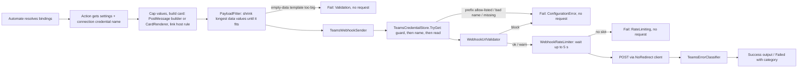

# Design: Automate Microsoft Teams connector

| | |
|---|---|
| Package | `Umbraco.Community.Automate.MicrosoftTeams` |
| Owner | Pascal Meyer |
| Scope | Workflows webhook connector only. Graph comes later, and only if people ask |
| Priority | Low. Built after the bigger packages (portfolio order: last of 8) |
| Targets | Umbraco CMS `[17.8.0, 18)` with Automate `[17.5.1, 18)`, and CMS `[18.3.0, 19)` with Automate `[18.5.1, 19)`, from one branch |
| Size | Manual 12-15 days. AI-assisted about 6-8 working days of build, plus waiting time on Jira Task 0 and the credential-helper contract freeze (re-estimated 2026-10-30 after the plan review, P14; was 3-4) |
| Source | Scope notes kept in the package workspace, outside this repo (research and deep scope). Their Decisions section wins |
| Written | 2026-10-29. Updated 2026-10-30 for the security review and the secret-custody council verdict (see "Security review changes (2026-10-30)" at the end) |

**Tags used in this doc**
- **[verified]**: read or fetched in the 2026-10-29 research session.
- **[unverified]**: recalled or inferred. Check it before relying on it. Most are covered by an M0 spike.
- **(architect's call)**: decided here, not by Pascal. The builder may change it with a reason.

Everything was true on 2026-10-29. Automate moves fast, so re-check the Automate items before you start.

---

## 1. Intent and why

**What it is:** an Umbraco Automate connector that posts messages and Adaptive Cards to a Microsoft Teams channel through a Teams **Workflows** (Power Automate) webhook. It's the Teams equivalent of HQ's `Umbraco.Automate.Slack`.

**Why it should exist:**
- No Teams package exists for Automate, or for Umbraco generally [verified, NuGet and Marketplace].
- HQ has no Teams plans. No issue, PR or discussion in `umbraco/Umbraco.Automate` [verified].
- The only indirect route is HQ's Zapier integration. It needs a paid Zapier account and only covers publish events [verified].

**Value over the built-in HTTP Request action.** HTTP Request can already POST JSON to a Workflows URL with bindings [verified]. So this package must clearly beat "paste JSON into HTTP Request". It wins on:

| | HTTP Request | This package |
|---|---|---|
| Webhook URL | Pasted into every step, often in plain view, or held in `Umbraco:Automate:Secrets:*` where any HTTP Request step can resolve it | Held in server config under a package-only key (`Umbraco:Automate:MicrosoftTeams:Credentials:{name}:WebhookUrl`). Never in the database, and no Automate step can resolve it. The connection holds only the credential name |
| Card JSON safety | `${ }` bindings are raw string substitution. A page called `Rock "n" Roll` breaks the JSON | Data is inserted into a parsed JSON tree. Can't break the JSON |
| Injection | Form data can inject markdown links | Markdown and bare links in data are neutralised by default. Buttons only go to the site's own hosts unless the author allows more |
| Cards | Write your own | 4 ready-made templates |
| Errors | A raw status code | Teams-specific messages ("The workflow was deleted or turned off") |
| Size | Teams rejects it, the step fails, and 10 failures switch the automation off | Long data values are shortened to fit. The post still goes out |
| Throttling | 429s fail the step | A per-webhook token bucket keeps posts under Teams' limit |
| Retired URLs | Silent failure | Blocks old Office 365 connector URLs with a clear message |

---

## 2. Goals, non-goals and anti-goals

**Goals (MVP)**
- One connection type: a named package credential that resolves to a Teams Workflows webhook URL, treated as a secret and never stored in the database.
- Two actions: **Post message** and **Post Adaptive Card**.
- Four built-in card templates: Content published, Approval needed, Form submitted, Simple.
- Teams-specific error categories that work with Automate's step Retry.
- One codebase that ships a 17.x and an 18.x package.
- Docs: Workflows setup, secrets, rotation, ownership, and a no-code "message received" recipe.

**Non-goals (not in the MVP)**
- Graph API, OAuth or an Entra app registration (phase 2, only on demand).
- Any trigger, including "Teams message received". A docs recipe covers it.
- Message IDs, threads, replies, edits, deletes, or posting to chats.
- Team and channel pickers.
- Full Adaptive Card Templating (`$when`, `$data` loops, expressions).
- `Action.Submit` or any interactive card that calls back to Umbraco (Workflows doesn't support it [verified]).
- Named action outcomes (see decision notes under section 5).
- Any backoffice client code. The UI comes from Automate's `[Field]` attributes.

**Anti-goals: it fails if any of these happen, even if it works**
- **The webhook URL leaks**: in a log, telemetry, an exception message, a validation message, the run log, an export or a Deploy transfer, or through another Automate step resolving it. The `sig=` in the URL gives anyone posting rights.
- **Site data can post a phishing link** "from the site" because a form value turned into a clickable link, or a button labelled "Open in backoffice" goes somewhere else.
- **Site visitors can switch the alerts off**: data they control makes steps fail until Automate's circuit breaker disables the automation (security review F01).
- **Personal data goes to Teams by default** (for example, form field values in the Form submitted template).
- **It's no better than HTTP Request**: if the cards are no safer, or the credential is no better protected. Setup does take one more step than before (a server config value, set by whoever runs the site), which the council accepted as the price of credential isolation. See Q2 in section 13.
- **Saved automations break on upgrade** because an alias or settings property was renamed.
- **It drags in heavy dependencies**, for example `AdaptiveCards.Templating` and its Bot Framework chain.
- **It forces two branches** to maintain for a package this small.
- **It raises the minimum Core version** for a feature the MVP doesn't need.

---

## 3. Users and core use cases

**Users**
- **Site implementer** (agency developer or Umbraco admin): creates the Workflow in Teams, adds the connection, builds the automations.
- **Site operator** (whoever controls the site's config: Umbraco Cloud secrets, environment variables or Key Vault): stores the webhook URL under the credential name. Often the same person as the implementer, but they need config access, not only backoffice access.
- **Workspace members** (any user group an admin adds, often editors): build and publish automations in a workspace. They are trusted to post to every channel whose connection is allowed in their workspace, no more (security review F12).
- **Editors and comms staff**: read the cards in Teams and click through to the backoffice or the live page.
- **Ops or IT**: get security alerts in their channel.
- **Client IT**: owns the Teams tenant and may own the Workflow.

**Core use cases**

| # | Use case | Trigger | Output |
|---|---|---|---|
| 1 | Page awaits approval | Content Saved, filtered to e.g. `newsArticle`, then Request Approval | "Approval needed" card to `#web-editors` with an "Open in backoffice" button |
| 2 | Form submission alert | Forms "entry submitted" (from `Umbraco.Automate.Forms`, alias [unverified]) | "Form submitted" card: form name, entry ID, link. **No personal fields** |
| 3 | New content live | Content Published | "Now live: {title}" card with the public URL, to the comms channel |
| 4 | Backoffice security alert | User Locked or User Login Failed (built-in [verified]) | Plain message to the ops channel |
| 5 | Weekly stale-content nudge | Scheduled Trigger, then Find Content | Summary message. Pairs with package 10 |
| 6 | "Message received" (docs only) | A Teams Workflow posts to Automate's built-in Webhook trigger | Whatever the automation does next. No code in this package |

---

## 4. Constraints

**One branch, two builds (17 and 18)**
- Decision 7: one `main` branch with an MSBuild switch, `AutomateMajor=17|18`.
- The APIs used are identical on both lines [verified].
- Each build produces the same package ID with a different major:
  - `17.x.y` depends on `Umbraco.Cms.Core [17.8.0, 18.0.0)` and `Umbraco.Automate.Core [17.5.1, 18.0.0)`;
  - `18.x.y` depends on `Umbraco.Cms.Core [18.3.0, 19.0.0)` and `Umbraco.Automate.Core [18.5.1, 19.0.0)`.
- **CMS floors (Pascal, 2026-10-30, every package in the portfolio):** `[17.8.0, 18)` and `[18.3.0, 19)`. The package takes a direct `Umbraco.Cms.Core` dependency only to enforce the floor, because NuGet resolves the lowest version that satisfies a range, and Automate alone would let a site sit on an older CMS (security review R9).
- **Automate floors stay 17.5.1 / 18.5.1.** Checked against the nuspecs on nuget.org on 2026-10-30 [verified]:
  - `Umbraco.Automate.Core` 17.5.1 needs `Umbraco.Cms.*` `[17.6.0, 17.999.999)`, so it runs on CMS 17.8.0.
  - `Umbraco.Automate.Core` 18.5.1 needs `Umbraco.Cms.*` `>= 18.1.0`, so it runs on CMS 18.3.0.
  - 17.5.1 and 18.5.1 are the newest Automate releases on each line, and the oldest with `VisibleWhen` (29 Sep 2026 [verified]). So the CMS floors don't move the Automate floors.
  - `Umbraco.Automate.Testing` 17.5.1 / 18.5.1 pin Core at the same versions.
- Why two packages, not one `[17.5.1, 19)` package: Automate packages are version-locked per major, like HQ's own add-ons [verified]. A single range would install on 18 with a 17-built binary.
- Both lines target `net10.0` (same as Slack [verified]).
- If the APIs drift apart later, split into `v17/main` and `v18/main` (decision 7).

**Office 365 connectors are retired**
- Connector-based incoming webhooks were retired in May 2026. The rollout finished on 22 May 2026 [verified, Microsoft Learn].
- Workflows is the only webhook route left.
- Old URLs look like `https://<tenant>.webhook.office.com/...`. These must be blocked with a clear message (decision 6).
- The docs must say "Workflows webhooks, not Office 365 connectors" in the first screen.

**Data must not be able to fail a step (security review F01)**
- Automate's circuit breaker disables an automation after 10 consecutive failed runs, or at a 70% error rate over 20 runs after a 24 h grace period [verified, `CircuitBreakerOptions` on v17 and v18].
- So any failure that site data can cause is an off switch for the alert. An anonymous visitor submitting a form 10 times is enough.
- Rule: **the package fails a step only for things the author or admin controls** (bad template, bad connection, missing credential, Teams refusing the URL). Data-driven problems are fixed in the payload, with a warning, and the post still goes out.

**28 KB limit**
- Teams rejects messages over 28 KB [verified].
- Default `MaxPayloadBytes = 28000` (slightly under 28 KiB, so there's a margin).
- **Value cap:** every bound data value (`CardData` values, Post message `Data` values, bound `Title`, `Message` and `Summary`) is cut to `MaxValueLength` (default 2,000 UTF-16 chars) on a grapheme boundary, with `…` appended. A warning names the key or field, never the value.
- **Fit to budget:** if the rendered UTF-8 payload (after escaping and JSON serialisation, so escape expansion is counted) is still over `MaxPayloadBytes`, the fitter works in a fixed order (plan review P5):
  1. render with every value empty; if that is over, stop with `Validation` (below);
  2. up to 64 rounds: halve the longest value (on a grapheme boundary, with `…`) and re-render;
  3. if still over, empty values longest-first, re-rendering after each, until it fits. Step 1 guarantees this ends with a payload that fits.
- Warnings come from the final render only, de-duplicated, plus one line per shortened or removed key (key only).
- **Fail with `Validation` only when the template with all data empty is already too big.** That's the author's mistake, not an attacker's. No data can reach the sender's final size check, which stays as defence in depth.

**Throttling**
- More than 4 requests per second to a webhook gets HTTP 429 [verified].
- **Per-webhook token bucket (reverses the earlier "no limiter" call, security review F01):** default 3 requests/second, burst 4, wait at most 5 s, always inside the step timeout. One bucket per credential name, per process. Connections that share a credential name share a bucket, because Teams limits per webhook.
- Why no shared state: N nodes × 3 rps is still a bound, and most sites run 1 to 2 nodes. The earlier reason for "no limiter" (shared state across servers) doesn't hold for a bound this loose.
- Why it matters: Core already caps one automation at 60 runs a minute [verified], which is under 3 rps. The bucket protects the case Core doesn't: several automations sharing one webhook.
- **When the wait would exceed 5 s** the step fails with `RateLimiting` (pending Pascal, Q3 in section 13: the alternative is to skip the post and succeed with a warning).
- 429 from Teams still maps to `RateLimiting`, so the step's Retry setting can back off.
- Docs: one webhook per alerting automation (then the bucket never starves); Retry with backoff for `RateLimiting`; one summary from batch triggers, not one post per item; how the circuit breaker interacts.

**Secrets: package-owned credentials (council verdict, accepted by Pascal 2026-10-30)**
- The Workflows URL contains a `sig=` SAS signature. **Anyone with the URL can post to the channel.** Treat it like a password.
- **Why not `$Umbraco:Automate:Secrets:*`:** Automate resolves that prefix into *any* sensitive field on *any* step type, embedded or whole [verified, `ConfigurationReferenceResolver`, v17.5.1 and v18.5.1]. The built-in HTTP Request action has a free URL and sensitive, bindable headers. So any workspace member could send the Teams URL to any host. The council (transcript `council-output/council-transcript-2026-10-30T005858.md`) chose package-owned credentials for all three connector packages.
- **Where the URL lives:** server configuration, under `Umbraco:Automate:MicrosoftTeams:Credentials:{name}:WebhookUrl` (Umbraco Cloud secret, environment variable `Umbraco__Automate__MicrosoftTeams__Credentials__{name}__WebhookUrl`, or Key Vault). That prefix is not in Automate's `AllowedConfigurationKeyPrefixes` (default `Umbraco:Automate:Secrets` and `Umbraco:Automate:Variables`, matched segment by segment [verified]), so no Automate step can resolve it.
- **What the connection stores:** the credential **name** only, in a non-sensitive field. The name resolves to the whole URL, and the package posts only to that value. Nothing secret is in the database, so there is nothing to encrypt, mask or strip, and nothing hand-rolled.
- **Nothing is entered directly in 1.0.** There's no URL field and no `$`-reference mode. The literal-or-whole-value restriction from the security review (F02) has nothing left to apply to, except that the credential-name field rejects anything that isn't a plain name (so a pasted URL or `$` reference is refused and never stored in plain text). A literal-URL fallback is a decision for Pascal: Q2 in section 13.
- **Shared helper:** `TeamsCredentialStore`, copied verbatim from the Jira package under the shared contract (`../credential-helper-contract.md`, version 1.0.0). Jira hosts the canonical source, the isolation spike (Jira Task 0) and the conformance suites. Only the class name, prefix and parts enum are Teams-specific. See 7.7.
- **Fail closed:** if Automate's allow-list ever covers the package's credential section (an upgrade or a site config change), the package refuses to resolve credentials and says why. See 7.7.
- **Honest claims.** README, SECURITY.md and the Test connection output say exactly this, no more:
  - the package only ever posts to the URL stored under the connection's credential name;
  - Automate authors can't read the raw URL through Automate;
  - Automate section access to a workspace that allows the connection still means the ability to post to that channel;
  - credential names are site-wide, not per workspace. Only admins can create connections [verified, `RequireAdmin`], so only admins choose which name a connection uses.
- Our code never logs, throws or returns the URL. See section 7.5.

**Pitfalls reference items that apply**
- **P2 (Critical, Security):** no static references to scoped instances. Every package service is a singleton holding only singleton-safe dependencies: `IHttpClientFactory`, `IConfiguration`, `IOptionsMonitor<>`, `ILogger<>`, `TimeProvider`, `IDomainService` (an Umbraco singleton service) and our own singletons. The rate limiter's bucket map and the site-host cache are instance fields on singletons, never statics.
- **P1:** everything through DI. No statics, no service locator.
- **S4 (High, Security):** applies to the "message received" recipe. The inbound Automate webhook must use an authenticator. See section 10.
- S1, S3 and S5 don't apply: there are no controllers, no custom property editors and no surface controllers.

**Other constraints**
- **Aliases are frozen at first release.** Automations store them. Use the `community.teams.` prefix so a future HQ `teams.*` package can't collide.
- Settings property names are also stored. Treat them as frozen too (architect's call).
- No live Teams calls in CI. The URL would be a CI secret that gives posting rights.

---

## 5. Decisions already made (Pascal, 2026-10-29)

| # | Decision |
|---|---|
| D1 | **Build it, at low priority.** It comes after the bigger packages. The value over HTTP Request is the shared encrypted connection, safe templates and clear errors |
| D2 | **Webhook (Workflows) first.** Graph only if people ask for it |
| D3 | **Templating uses our own `{{key}}` format**, not `AdaptiveCards.Templating` |
| D4 | **NuGet ID: `Umbraco.Community.Automate.MicrosoftTeams`** |
| D5 | **1.0 templates are all four:** Content published, Approval needed, Form submitted (no personal data) and Simple |
| D6 | **URL check: warn on unknown hosts.** Block only `http://` and `*.webhook.office.com`. Confirmed for 1.0 on 2026-10-30, with two additions: the host is never echoed at run time, and an opt-in `StrictHosts` ships |
| D7 | **One branch with a build switch** for v17 and v18. Move to separate branches if the APIs drift apart |
| D8 | **(2026-10-30) CMS floors** `[17.8.0, 18)` and `[18.3.0, 19)`, for every package |
| D9 | **(2026-10-30) Secret custody:** package-owned credentials per the council verdict. Same internal helper as Jira. Fail-closed guard |
| D10 | **(2026-10-30) F01:** cap and truncate data values instead of failing; per-webhook token bucket; public-form floods must not trip the circuit breaker |
| D11 | **(2026-10-30) F14** (Deploy and connection settings) is settled in spike S2 before 1.0 |

Portfolio rules that also apply (README, 2026-10-29):
- Neutral `Umbraco.Community.*` IDs. Never rename Automate aliases.
- One build where possible.
- Pascal owns the package in his own GitHub repo and NuGet account. It can move to an organisation later.
- Reserve the ID early with a `0.0.1-alpha`.

Scope defaults carried over from the deep scope (accepted with the open questions):
- **No named outcomes in v1.** A Teams post works or fails, and failures must stay failures so Retry works. Declaring outcomes would push the minimum Core version up to whichever release ships PRs #445 / #449.
- **Post message always wraps its text in an Adaptive Card**, because Workflows templates expect `attachments` [unverified that bare `{"text"}` fails everywhere, so wrap to be safe].

---

## 6. Functional spec (MVP)

### 6.1 Connection: Teams Workflow webhook

| | |
|---|---|
| Alias | `community.teams.workflowWebhook` |
| Display name | "Microsoft Teams (Workflows webhook)" |
| Base class | `ConnectionTypeBase<TeamsWorkflowConnectionSettings>` (not the OAuth base) |
| Group / icon | "Messaging" / `icon-message`, like Slack (architect's call) |
| Setup docs URL | The package's Workflows setup page |

**Settings**

| Property | Type | Required | Sensitive | Group | Notes |
|---|---|---|---|---|---|
| `CredentialName` | string | yes | no | | A plain name. Trimmed, ASCII only, lower-cased, then `^[a-z0-9]{1,32}\z` (contract 1.2). The package reads `Umbraco:Automate:MicrosoftTeams:Credentials:{normalised name}:WebhookUrl`. Description: "The name of the webhook credential in your site's configuration: 1 to 32 letters or digits. Ask whoever manages the site's secrets." plus the setup docs link |
| `DefaultCardVersion` | dropdown `1.2` / `1.3` / `1.4` / `1.5` | no, default `1.4` | no | Advanced | See 7.4 for how it's used |

- There is no `WebhookUrl` field and no `IsSensitive` field on this connection (D9).
- Name rule (contract 1.2, shared with Jira): only 1 to 32 ASCII letters or digits after trimming; case doesn't matter (`Editors` and `editors` are the same credential). `..`, `:`, `/`, `$`, `-`, `_`, `.`, inner whitespace, non-ASCII look-alikes, an empty name and anything over 32 chars are rejected. The error never echoes what was typed ("Credential name must be 1 to 32 letters or digits."), because a mistake here is usually a pasted URL.
- **Save-time check** (spike S3): a `ConnectionSavingNotification` handler (public and cancellable on both lines [verified]) cancels the save when `TeamsCredentialStore.TryNormaliseName` rejects the name. If S3 finds the handler can't see the raw value, the same rule runs at Test and before every send, and the docs say so.

**Test connection**
- Runs the fail-closed guard (7.7), then resolves the credential, then the URL checks (7.6). A block fails before any request is sent.
- Missing credential: the contract's text, "No value is configured at Umbraco:Automate:MicrosoftTeams:Credentials:{name}:WebhookUrl." (normalised name). The name is not secret; the value never appears.
- Then posts a small card: "Connection test from {site name}" (site name from `Umbraco:CMS:WebRouting:UmbracoApplicationUrl`, or "your Umbraco site").
- Safe to post: `ValidateAsync` only runs from the explicit Test button [verified, `ConnectionService.TestConnectionAsync` is the only caller].
- Success text: "Connected (Teams accepted the message)." followed by the honest-claims line: "Anyone who can build automations in a workspace that allows this connection can post to this channel."
- Unknown host: `ConnectionValidationResult.Warning` (exists on both lines [verified]): "Connected, but `<host>` isn't a known Power Automate host. Check the URL." The host is shown **only here** (admin-only Test result), and only when it passes a DNS-label check (letters, digits, `-`, `.`, at most 253 chars). Otherwise "the webhook host" is used (security review F02 (c)).
- Credential set in a committed appsettings file: warning "This credential is set in an appsettings file. Move it to an environment variable or a secret store." (council condition 7). Found by `TeamsCredentialSourceCheck`, which asks the configuration providers which one supplied the key; the value is discarded, never returned, shown or logged.
- No site hosts configured for links (7.3): warning "Buttons will be dropped. Set `Umbraco:CMS:WebRouting:UmbracoApplicationUrl` or `AllowedLinkHosts`."

**Acceptance criteria**
- **Given** credential `Editors` set in configuration to a valid Workflows URL, **when** I click Test connection, **then** a test card appears in the channel **and** I see "Connected (Teams accepted the message)".
- **Given** a credential name with no configured URL, **when** I test, **then** I see the missing-credential message naming the credential **and** no request is sent.
- **Given** I type a URL or `$Umbraco:Automate:Secrets:X` into the credential-name field, **when** I save (or test, if S3 finds no save hook), **then** it's refused **and** the error doesn't repeat what I typed.
- **Given** a credential holding an `https://<x>.webhook.office.com/...` URL, **when** I test, **then** I see "This is a retired Office 365 connector URL. Create a Workflows webhook instead." with a docs link, **and** no request is sent.
- **Given** a credential holding an `http://` URL, **when** I test, **then** it fails before any request is sent.
- **Given** a credential on a host outside `AllowedHosts` and `StrictHosts` off, **when** I test, **then** the request is sent **and** the result carries the unknown-host warning. With `StrictHosts` on, it's blocked and nothing is sent.
- **Given** a saved connection, **when** I export the automation or transfer the connection with Deploy, **then** only the credential name travels **and** the target resolves its own environment's URL (spike S2, F14).
- **Given** a failed request, **when** I view the run log, the site logs or exported telemetry, **then** the URL (including `sig=`) appears nowhere.
- **Given** an HTTP Request step with `$Umbraco:Automate:MicrosoftTeams:Credentials:Editors:WebhookUrl` in its URL or a header, **when** it runs, **then** the reference is not resolved to the URL (council test 1).
- **Given** a site that adds `Umbraco:Automate:MicrosoftTeams` (or any parent or child of the credential section) to `AllowedConfigurationKeyPrefixes`, **when** a Teams step runs or I test, **then** it fails with the fail-closed message **and** nothing is sent.

### 6.2 Action: Post message

| | |
|---|---|
| Alias | `community.teams.postMessage` |
| Display name | "Post Teams message" |
| Base class | `ActionBase<PostMessageSettings, TeamsPostOutput>` |
| Connection | `ConnectionTypeAlias = "community.teams.workflowWebhook"` |

**Inputs**

| Property | Type | Required | Bindings | Notes |
|---|---|---|---|---|
| `Title` | string | no | yes | Bold heading TextBlock. May use `{{key}}` from `Data` |
| `Message` | multi-line string | yes (save time) | yes | Teams markdown subset in Markdown mode. May use `{{key}}` from `Data` |
| `Data` | key/value rows (same editor as `CardData`) | no | **yes, per row value** | New (F03). Values are escaped like `CardData` and inserted at `{{key}}` in `Title` and `Message`. Keeps author markdown and untrusted data apart |
| `LinkUrl` | string | no | yes | Rendered as one `Action.OpenUrl`. Host rule in 7.3 |
| `LinkLabel` | string | no | yes | Default "Open" (architect's call) |
| `Style` | dropdown: Default / Good / Warning / Attention | no, default Default | no | Container style |
| `Formatting` | dropdown: Plain text / Markdown | no, **default Plain text** (F03) | no | Plain escapes markdown and breaks links in Title and Message. Markdown description: "Bound data in Title and Message isn't escaped. Put untrusted values in Data instead." |
| `AllowExternalLinks` | bool, default `false` | no | no | Group "Advanced". Lets `LinkUrl` go to hosts outside `AllowedLinkHosts` (F04) |

**Behaviour**
- Build the card in code with `System.Text.Json` nodes, never by string concatenation. So any bound text is JSON-safe.
- Card version: the connection's `DefaultCardVersion`.
- Bindings are resolved by Automate **before** the action runs, by plain string substitution [verified, `BindingEvaluator.Stringify`]. So in Markdown mode the action can't tell the author's markdown from bound data. **Consequence:** Plain text is the default; in Markdown mode, untrusted values belong in `Data`, which is always escaped (unless the author turns escaping off). Say this in the field descriptions and the docs.
- `{{key}}` in `Title` and `Message` is replaced once from `Data`, with the same rules as the card renderer (7.3): no re-substitution, unknown key gives empty text and a warning.
- Value cap and fit to budget (section 4) apply to bound `Title`, `Message` and every `Data` value.
- `LinkUrl` must be an absolute `https://` URL after binding, on an allowed link host (7.3) unless `AllowExternalLinks` is on. If not, drop the button and add a warning to the output; the message still posts (architect's call: a missing button is better than a lost alert).
- **Blank `Message` after binding** (the bound value was empty): post "(no message text)" with a warning, rather than failing. A blank `Message` *field* is a save-time error instead. Architect's call under F01: visitors control bound values, so a blank value mustn't fail the step.
- **Publish validation** (`IPublishValidatableStepType`, new for this action, F06): see 6.5.

**Output: `TeamsPostOutput`** (shared by both actions)

| Property | Type | Notes |
|---|---|---|
| `StatusCode` | int | HTTP status from Teams |
| `Accepted` | bool | True for any 2xx. Means "Workflows accepted it", not "delivered" |
| `PayloadBytes` | int | UTF-8 bytes sent |
| `Warnings` | string[] | Unknown keys, dropped links, shortened values (key only), possible personal data (key only), unknown host (without naming it). Empty when none (architect's call, see 7.3) |

- No message ID. Workflows returns `202` with no body [unverified, spike S1]. Graph (phase 2) would add it.
- A `202` means the flow was queued. The flow's own "post card" step can still fail later inside Power Automate. Say so in the docs.

**Acceptance criteria**
- **Given** a message with `${ content.name }`, **when** the automation runs, **then** the bound name appears in the channel.
- **Given** a bound name containing `"`, `\` and `}`, **when** the step runs, **then** the JSON is valid and the text appears exactly.
- **Given** the `Message` field is empty, **when** I save the automation, **then** the save is blocked.
- **Given** `Message` is only a binding whose value is empty at run time, **when** the step runs, **then** "(no message text)" is posted **and** `Warnings` says so.
- **Given** a new Post message step, **when** I open it, **then** Formatting is Plain text.
- **Given** Formatting is Plain text and the message contains `[Click](https://evil.example)` or `https://evil.example/login`, **when** posted, **then** both show as literal, non-clickable text.
- **Given** Markdown mode and a `Data` row `name = [x](https://evil.example)` used as `{{name}}`, **when** posted, **then** the author's markdown renders **and** the data value is literal.
- **Given** Teams returns 429, **when** the step runs, **then** it fails with `RateLimiting`.
- **Given** Teams returns 404, **when** the step runs, **then** it fails with `ConfigurationError` and says "The workflow was deleted or turned off".
- **Given** a bound value of 100 KB, **when** the step runs, **then** the post is sent at `MaxPayloadBytes` or less **and** `Warnings` names the shortened field.
- **Given** `LinkUrl` binds to `/news/item`, or to `https://evil.example` with `AllowExternalLinks` off, **when** posted, **then** the message posts without a button **and** `Warnings` explains why.

### 6.3 Action: Post Adaptive Card

| | |
|---|---|
| Alias | `community.teams.postCard` |
| Display name | "Post Teams Adaptive Card" |
| Base class | `ActionBase<PostCardSettings, TeamsPostOutput>` |
| Also implements | `IValidatableStepType` (save), `IPublishValidatableStepType` (publish) [verified in docs] |

**Inputs**

| Property | Type | Required | Bindings | Notes |
|---|---|---|---|---|
| `CardSource` | dropdown: Content published / Approval needed / Form submitted / Simple / Custom | yes, default Simple (architect's call) | no | |
| `CustomCardJson` | code editor (JSON) | when Custom | **no** | `VisibleWhen = CardSource` is Custom. Uses `{{key}}` placeholders |
| `CardData` | key/value rows (`UmbracoAutomate.PropertyEditorUi.KeyValueEditor` [verified on v17 and v18]) | depends on template | **yes, per row value** | Keys are plain text. Values are escaped by us. Description adds "Values are shown in the run log to workspace members" (F13) |
| `Summary` | string | no | yes | Notification preview text. Mapping in 7.4 |
| `EscapeMarkdownInData` | bool, default `true` | no | no | Group "Advanced" |
| `AllowExternalLinks` | bool, default `false` | no | no | Group "Advanced". Custom cards only: lets URL properties go to hosts outside `AllowedLinkHosts` (F04). Built-in templates always apply the host rule |

- `CustomCardJson` has bindings **off** on purpose. Authors put data in `CardData` and reference it with `{{key}}`. This is the whole JSON-safety model (D3).
- Output: `TeamsPostOutput` (6.2).

**Built-in templates (D5)**

Embedded JSON files, card version `1.4`. Elements used: `TextBlock`, `FactSet`, `ColumnSet`, `Action.OpenUrl` only. Key names are the architect's call; once released they're frozen like aliases.

| Template | Required keys | Optional keys | Looks like |
|---|---|---|---|
| Content published | `title`, `url` | `contentType`, `editor`, `publishedAt` | "Now live: {title}", facts, "View page" button |
| Approval needed | `title`, `url` | `editor`, `requestedAt`, `notes` | "Approval needed: {title}", facts, "Open in backoffice" button |
| Form submitted | `formName`, `url` | `entryId`, `submittedAt` | "New entry: {formName}", facts, "View entry" button |
| Simple | `title`, `text` | `url`, `linkLabel` | Heading, text, optional button |

- **Form submitted carries no personal data by design.** It has no generic "extra fields" slot. Extra `CardData` rows are ignored by built-in templates (only placeholders in the template render). Anyone who wants field values must use Custom, on purpose.
- Whether templates set `"msteams": { "width": "Full" }` is the builder's call after the rendering spike (S5).
- Link labels say where they go ("Open in backoffice"), never "Click here" (accessibility).

**Validation**
- **Save time** (`IValidatableStepType`):
  - Custom: the JSON parses. Error if not; the save is blocked.
  - Custom: the root is `{"type":"AdaptiveCard",...}` or a full `{"type":"message","attachments":[...]}` envelope. Error otherwise.
  - Custom: any `{{key}}` with no matching `CardData` row gives a **warning**, not an error.
  - Duplicate `CardData` keys (case-insensitive): error (architect's call).
  - Custom JSON contains `Action.Submit`: warning, since Workflows doesn't support it.
- **Publish time** (`IPublishValidatableStepType`):
  - A built-in template's required keys must have a row. Message: "Approval needed card needs a url value".
  - The connection choice rule in 6.5 (F06).
- (Plan note, unchanged: Core treats every save-time string as an error, so the two save-time *warnings* above move to run time.)

**Acceptance criteria**
- **Given** a page name containing `"` and `}`, **when** the card is posted, **then** it renders and the JSON stays valid.
- **Given** a form value `[Click me](https://evil.example)` with escaping on, **when** posted, **then** it shows as literal text, not a link.
- **Given** escaping off, **when** the same value is posted, **then** it renders as markdown (the author chose this).
- **Given** invalid custom JSON, **when** I save the automation, **then** I get a field error **and** the save is blocked.
- **Given** the Approval needed template without a `url` row, **when** I publish, **then** publish is blocked with "Approval needed card needs a url value".
- **Given** a custom card using `{{missing}}`, **when** it runs, **then** that text renders empty **and** `Warnings` names `missing`.
- **Given** a custom full `message` envelope, **when** posted, **then** it's sent as-is (after substitution), not double-wrapped.
- **Given** the Form submitted template with an extra `email` row, **when** posted, **then** the email does not appear in the card.
- **Given** 20 `CardData` values of 2,000 characters each, **when** the step runs, **then** a card of `MaxPayloadBytes` or less is sent **and** `Warnings` names the shortened keys.
- **Given** a Custom card whose template is over `MaxPayloadBytes` with all data empty, **when** the step runs, **then** it fails with `Validation` before sending.
- **Given** the Approval needed template with `url` bound to `https://evil.example/login`, **when** posted, **then** the "Open in backoffice" button is dropped **and** `Warnings` explains why.
- **Given** a Custom card with `AllowExternalLinks` on, **when** a button points at an external https host, **then** it's kept.
- **Given** a `CardData` key `email` on a Custom card, **when** posted, **then** it's sent **and** `Warnings` says the key may hold personal data.

### 6.4 Triggers

- **None in the MVP.** "Message received" is a docs recipe (section 10).

### 6.5 Connection choice at publish (security review F06)

- Automate gives a step with no `ConnectionId` the **first** allowed connection of its type, with only a log warning [verified, `ActionStepBody.ResolveConnectionByTypeAsync`].
- Both actions implement `IPublishValidatableStepType`. Publish is blocked when a step of this action has no `ConnectionId` **and** the workspace allows more than one `community.teams.workflowWebhook` connection: "Choose which Teams connection this step posts to."
- One allowed connection: publish is allowed.
- Spike S7 confirms that `ValidateSettingsForPublishAsync` can read the step's `ConnectionId` and the workspace's allowed connections [LOW until then]. If it can't, the fallback is a run-time warning plus docs, and the gap goes to Pascal before 1.0.
- Docs: one connection per channel; always pick the connection on the step.

---

## 7. Technical design

### 7.1 Project layout (mirrors `Umbraco.Automate.Slack`)

```
Umbraco.Community.Automate.MicrosoftTeams/
  Directory.Build.props          (AutomateMajor switch, shared metadata)
  Directory.Packages.props       (central versions, ranges per AutomateMajor)
  umbraco-marketplace.json
  src/Umbraco.Community.Automate.MicrosoftTeams/
    Connection/     TeamsWorkflowConnectionType.cs, TeamsWorkflowConnectionSettings.cs, TeamsConnectionSavingHandler.cs
    Credentials/    TeamsCredentialStore.cs (copied verbatim from Jira under the contract; holds the store and
                    TeamsCredentialStoreStartupCheck), TeamsCredentialPart.cs, TeamsCredentialSourceCheck.cs
    Actions/        PostMessageAction.cs (+Settings), PostCardAction.cs (+Settings), TeamsPostOutput.cs, ConnectionChoiceValidator.cs
    Cards/          CardRenderer.cs, CardTemplates.cs, MarkdownEscaper.cs, ValueLimiter.cs, PayloadFitter.cs,
                    UrlProperties.cs, Templates/*.json (embedded)
    Links/          SiteHostProvider.cs, LinkHostPolicy.cs
    Http/           ITeamsWebhookSender.cs, TeamsWebhookSender.cs, TeamsErrorClassifier.cs, WebhookUrlValidator.cs,
                    WebhookRateLimiter.cs
    Configuration/  TeamsComposer.cs, TeamsOptions.cs
    UmbracoCommunityAutomateTeamsSchema.cs + buildTransitive/*.props   (appsettings IntelliSense)
  tests/Umbraco.Community.Automate.MicrosoftTeams.Tests.Unit/
    CredentialHelperContract/   the two contract suites (verbatim from Jira) + the Teams subclass file
  docs/             design.md, plan.md, spikes.md only (the user guide lives in README.md and SECURITY.md)
  README.md         setup, secrets, rotation, throttling, telemetry, who can post, GDPR, recipe
  SECURITY.md
```

**What Slack does that we copy** [verified]
- Connection and actions are found by attribute: `[ConnectionType(...)]` and `[Action(..., ConnectionTypeAlias = ...)]`. No manual registration.
- UI comes from POCO settings with `[Field(Label, Description, SortOrder, SupportsBindings, EditorUiAlias, EditorConfig, IsSensitive, Group, VisibleWhen)]`. No client code.
- Actions return `ActionResult.Success(output)` or `ActionResult.Failed(ex, StepRunErrorCategory.X)`.
- A `JsonSchemaGenerate` MSBuild target plus a `buildTransitive` props file gives sites appsettings IntelliSense.

**Where we differ from Slack**
- Plain `Microsoft.NET.Sdk` class library. Slack uses the Razor SDK but ships no client code [verified]. We have no frontend.
- Not OAuth. `ConnectionTypeBase<T>`, not `OAuthConnectionTypeBase<T>`.
- We have a tests project. Slack has none [verified].
- One branch with a switch, not `v17/dev` + `v18/dev`.

**Composer** registers, all as singletons:
- `TeamsOptions` bound to `Umbraco:Automate:MicrosoftTeams`, with its post-configure;
- `TeamsCredentialStore` and its `UmbracoApplicationStartedNotification` startup check, with exactly the two lines in contract 1.1;
- `TeamsCredentialSourceCheck`, `WebhookUrlValidator`, `ITeamsWebhookSender`, `WebhookRateLimiter`, `SiteHostProvider`, `LinkHostPolicy`, `CardTemplates`, `ICardRenderer`;
- `TimeProvider.System` if none is registered (the rate limiter's and the send timeout's clock, swapped for a fake in tests);
- the `ConnectionSavingNotification` handler (if S3 confirms it).

**Options section renamed (architect's call):** `Umbraco:Automate:Teams` becomes `Umbraco:Automate:MicrosoftTeams`, so options and credentials sit under one package section that matches the package ID. Nothing has shipped, so this costs nothing now. `TeamsOptions` has no `Credentials` property, so binding the options never reads a webhook URL.

**`TeamsOptions`** (`Umbraco:Automate:MicrosoftTeams`)

| Key | Default | Notes |
|---|---|---|
| `AllowedHosts` | `*.powerplatform.com`, `*.logic.azure.com`, `*.azure-apihub.net` | Warn-only list unless `StrictHosts` [unverified hosts, spike S1] |
| `StrictHosts` | `false` | New. When `true`, a host outside `AllowedHosts` is blocked, not warned (D6) |
| `AllowedLinkHosts` | empty | New (F04). Extra hosts buttons may link to, wildcard syntax as `AllowedHosts`. The site's own hosts are always allowed (7.3) |
| `MaxPayloadBytes` | `28000` | |
| `MaxValueLength` | `2000` | New (F01). Per data value, UTF-16 chars, cut on a grapheme boundary |
| `TimeoutSeconds` | `15` | |
| `RateLimit:RequestsPerSecond` | `3` | New (F01). Per credential name, per process |
| `RateLimit:Burst` | `4` | New (F01) |
| `RateLimit:MaxWaitSeconds` | `5` | New (F01). Capped at `TimeoutSeconds` |
| `Credentials:{name}:WebhookUrl` | none | The secret. Read only by `TeamsCredentialStore` (and, for the provider name only, `TeamsCredentialSourceCheck`), never bound to `TeamsOptions`. The appsettings schema describes the shape with no example values |

**Build switch**
- Same conventions as the Jira package (plan review P14: reuse, don't rebuild), so Jira's CI and release files run unchanged:
  - `AutomateMajor` (17 or 18) picks the Core, CMS and Testing ranges; default 18 (architect's call: the current line is the one developers open). `DefineConstants` adds `AUTOMATE_17` or `AUTOMATE_18`.
  - `eng/lines.txt` lists the shipped lines; `scripts/test.sh` runs every line.
  - `AutomateFloat=true` floats Automate and CMS to the newest release in the major (the CI "latest" leg). Lock files are per line (`packages.$(AutomateMajor).lock.json`); the floor leg restores with `--locked-mode`.
  - Version: `VersionPrefix = $(AutomateMajor).$(PackageMinor).$(PackagePatch)`, so the major always equals `AutomateMajor` by construction. A `release/<minor>.<patch>[-<suffix>]` tag packs every line in `eng/lines.txt`.
- **Release guard:** only CI publishes to NuGet, only from a `release/*` tag, and only once the repo is public (section 10). The earlier `GuardReleaseVersion` target is gone: the derived version can't mismatch.

**HTTP**
- `IHttpClientFactory.CreateClient(Constants.HttpClients.NoRedirect)` (F10). It exists on both lines [verified, `Constants.cs`] and, like `Default`, keeps the SSRF protection. Spike S4 confirms its primary handler is `SsrfProtectionHandler` [LOW until then]. If S4 also needs logging removed, register our own `community.teams` named client built the same way.
- Any 3xx maps to `InvalidResponse`: "Teams answered with a redirect. Check the webhook URL." The `Location` header is never read into a message or log.
- Per-request timeout from `TimeoutSeconds`, via a linked `CancellationTokenSource` created on the injected `TimeProvider` (so tests drive it with a fake clock, plan review P7). The rate limiter's wait counts against it.
- `POST`, `Content-Type: application/json; charset=utf-8`.
- Send with `HttpCompletionOption.ResponseHeadersRead` (F11). On a non-2xx, read at most 1,024 bytes from the stream, then dispose. Strip control and bidi characters, then scrub (7.5). The snippet goes in the step failure message only, never in a log.

### 7.2 Request flow



The URL exists only inside the sender, between `TeamsCredentialStore.TryGet` and the POST. Actions and the connection type pass the credential name, never the URL.

**Trust boundaries** (for `security-analyst`)
- **Site operator to Umbraco:** whoever controls server config sets the credential URL. Trusted.
- **Backoffice to Umbraco:** admins create connections and choose the credential name [verified, `RequireAdmin` on all connection controllers]. Trusted. Workspace members build and publish automations: trusted to post to every channel whose connection is allowed in their workspace, no more (F12).
- **Site data to the card:** bound values (content names, form values, user names). **Untrusted.** JSON-safe by construction, markdown and links neutralised by default, length-capped, and unable to fail the step.
- **Umbraco to Microsoft:** outbound HTTPS only, no redirects. The URL is the credential.
- **Microsoft to Teams users:** rendering and link handling, outside our control (spike S5 checks it).
- **Supply chain:** source, CI, NuGet, then the client site (section 10).
- No inbound endpoint in this package. The recipe uses Automate Core's own webhook trigger.

### 7.3 `{{key}}` templating and escaping (D3)

**Why not `${ }`:** Automate resolves `${ }` bindings before the action runs, by raw string substitution [verified]. Adaptive Card Templating also uses `${ }`. And `AdaptiveCards.Templating` 2.0.6 pulls in `Microsoft.Bot.AdaptiveExpressions.Core` [verified], which is Bot Framework and heavy.

**Rules**
1. Parse the template once into a `JsonNode` tree. Cache parsed built-in templates; clone per render (architect's call).
2. Walk **string values only**. Never property names, never numbers or booleans.
3. Replace each `{{key}}` with the data value. Pattern: `\{\{\s*([A-Za-z0-9_.-]+)\s*\}\}`.
4. Key match is **case-insensitive** (architect's call: editors type keys by hand).
5. A string can mix text and several placeholders: `"Now live: {{title}}"`.
6. Re-serialise with `System.Text.Json`. Quotes, braces and backslashes in data can't escape the string.
7. Unknown key: replace with empty and add `"Unknown card key: {key}"` to `Warnings`. Also log it at Warning level (key name only).
8. No escape syntax for a literal `{{` in v1 (architect's call). Document it.

**Markdown escaping** (`EscapeMarkdownInData`, default on)
- Applies to **data values only**. The author's own template text keeps its markdown.
- Characters escaped with a backslash: `` \ * _ [ ] ( ) # > - ` `` (the scope list plus backtick, architect's call).
- **Auto-link breaking (F03), always on with escaping, whatever S5 finds about backslashes:** insert U+200B after the `:` in `://`, after `www.`, and before `@` in email-shaped tokens. A copied URL then fails, which is the point. The zero-width fallback in section 8 becomes the baseline for links.
- **Not applied** to values placed in URL properties. Escaping breaks URLs.
- **URL properties are an explicit list (F05)**, matched case-insensitively and taken from the Adaptive Card schema stored in the repo: `url`, any property ending `Url`, `backgroundImage` (string form and `.url`), `poster`, `sources[].url`, `selectAction.url`. A test walks the schema and fails if a URI-format property isn't on the list.
- For URL properties instead, after substitution:
  1. the value must be an absolute `https` URL (`http` only when the matched site host is itself http, for local dev);
  2. its host (normalised: lower case, trailing dot stripped, `Uri.IdnHost`) must be a site host or in `AllowedLinkHosts` (F04), unless it's a Custom card or Post message with `AllowExternalLinks` on;
  3. if not, remove that action (or element) and add a warning (architect's call). This stops `javascript:`, relative and off-site links.
- **Site hosts** (`SiteHostProvider`): the host of `Umbraco:CMS:WebRouting:UmbracoApplicationUrl` plus the hosts of domains assigned in the content tree (`IDomainService`, cached for 5 minutes in the singleton). Built-in templates always apply the host rule.
- **Full `message` envelopes:** substitution, escaping and URL rules apply to **every** attachment, including non-Adaptive-Card ones (security review section 4.3).
- Templates only ever put a URL into `Action.OpenUrl.url`, never into markdown text.
- Post message in Plain mode uses the same `MarkdownEscaper` (with link breaking) on the whole Title and Message.
- **Order, so nothing is escaped twice (plan review P9):** split Title and Message into literal segments and `{{key}}` placeholders first. In Plain mode, escape each literal segment; in Markdown mode, leave literals alone. Then replace each placeholder with its escaped data value. Each character is escaped exactly once, and a key such as `{{form_name}}` still matches (escaping the whole string first would turn `_` into `\_` and break the key).
- **Bound text can pull in `Data` (accepted, low):** Automate binds `Title` and `Message` before the action runs, so a bound value containing `{{email}}` is substituted from the `Data` rows. The value still arrives escaped, and `Data` is the author's own list, so this only moves data the author already chose to send. The field descriptions say so.

**Personal data hint (F13):** a `CardData` or `Data` key matching a common personal-data name (`email`, `phone`, `mobile`, `address`, `postcode` as a whole word in the key, or exactly `name`, `firstName`, `lastName`, `fullName`; case-insensitive; built-in template keys such as `formName` never match) adds the warning "Card key '{key}' may hold personal data. See the GDPR notes." Advisory, never a block.

**Contract (sketch)**

```csharp
public sealed record CardRenderResult(string Json, int Bytes, IReadOnlyList<string> Warnings);

public interface ICardRenderer
{
    CardRenderResult Render(
        JsonNode template,                         // AdaptiveCard or message envelope
        IReadOnlyDictionary<string, string> data,  // case-insensitive keys
        CardRenderOptions options);                // EscapeMarkdown, CardVersion
}
```

### 7.4 Card renderer and envelope

1. Render placeholders (7.3).
2. **Version:**
   - built-in templates: keep their `1.4`;
   - Post message card: use `DefaultCardVersion`;
   - custom cards: keep the author's `version`; set `DefaultCardVersion` only if it's missing (architect's call).
3. **Wrap** a bare `AdaptiveCard` in the envelope [verified format]:
   ```json
   {"type":"message","attachments":[{"contentType":"application/vnd.microsoft.card.adaptive","content":{ ... }}]}
   ```
   A full `message` envelope is sent as-is.
4. **Summary:** set the envelope's `summary` and the card's `fallbackText` to `Summary` when given [unverified which one Teams uses for the notification preview; spike S5 decides].
5. **Measure** UTF-8 bytes of the final JSON. Over `MaxPayloadBytes`: `PayloadFitter` runs the fixed order in section 4 (empty-render check, up to 64 halvings of the longest value, then emptying values longest-first). Only when the render with all data empty is still over does the step fail with `Validation`: "Card is {n} bytes before any data is added. Teams allows about 28 KB. Shorten the template." Otherwise the fitter always returns a payload within budget, so data can't reach the sender's final size check, which keeps the old message as defence in depth.

### 7.5 Error mapping

| Situation | `StepRunErrorCategory` | Message (never contains the URL) |
|---|---|---|
| Credential section allow-listed (7.7) | `ConfigurationError` | The contract's guard text: "Refused: Umbraco:Automate:AllowedConfigurationKeyPrefixes contains '{entry}', which exposes Umbraco:Automate:MicrosoftTeams:Credentials. Remove that entry." |
| Bad credential name | `ConfigurationError` | "Credential name must be 1 to 32 letters or digits." (contract 1.2) |
| Credential missing | `ConfigurationError` | "No value is configured at Umbraco:Automate:MicrosoftTeams:Credentials:{name}:WebhookUrl." (contract 1.3) |
| URL blocked (`http://`, `*.webhook.office.com`, not a URL, unknown host with `StrictHosts`) | `ConfigurationError` | See 7.6 |
| Empty-data template too big | `Validation` | See 7.4. Data never causes this |
| Rate limiter has no slot within `MaxWaitSeconds` | `RateLimiting` | "Too many posts to this Teams webhook at once. Use the step's Retry setting." (pending Q3) |
| 3xx | `InvalidResponse` | "Teams answered with a redirect. Check the webhook URL." |
| 400 | `InvalidResponse` | "Teams rejected the card (400)." plus a scrubbed body snippet |
| 401 / 403 | `Authentication` | "Teams refused the webhook signature. Re-create the Workflow URL." |
| 404 | `ConfigurationError` | "The workflow was deleted or turned off." |
| 413 | `Validation` | "Teams says the message is too large." |
| 429 | `RateLimiting` | "Teams is throttling this webhook. Use the step's Retry setting." |
| 5xx | `ServiceUnavailable` | "Teams returned {code}. Try again later." |
| Our timeout | `Timeout` | "Teams didn't answer within {n} seconds." |
| Network error or SSRF handler block | `ServiceUnavailable` / `ConfigurationError` | "Couldn't reach Teams." / "The webhook host isn't allowed." (architect's call) |
| Host shutdown (the caller's token cancelled) | Let the cancellation through | |

**Rules for messages and logs**
- Build every exception and message ourselves. Never pass on `HttpRequestException.Message`, `RequestUri`, or `ToString()` of the request.
- `ActionResult.Failed(ex, ...)` gets **our own** exception type with our own message, not the original (the original may contain the URL). Keep the original's type name only, if useful. **`InnerException` is always null**: `ActionStepBody` re-throws it into WorkflowCore, which logs it with its inner chain [LOW, security review 4.1].
- `ValidateAsync` catches everything except caller cancellation and returns its own text, so Core's `ex.Message` fallback in `TestConnectionAsync` is never reached [verified fallback exists].
- Body snippet: control and bidi characters stripped, then at most 200 characters, with anything matching `sig=[^&\s"]+` or `https?://\S+` replaced by `[redacted]` (architect's call). It appears in the step failure message only.
- `ConnectionValidationResult.Failure` details show in the UI [verified]. Same rules.
- **Log only the status code and the byte count** (plan review P4, Pascal 2026-10-30): one Information line, "Teams webhook returned {StatusCode} ({Bytes} bytes)". **Never the host**, never the body, never the credential value. The host can carry a secret (F02 (c)), so it stays out of every log.
- `ValidatedWebhookUrl.ToString()` returns a fixed placeholder, never the host, path or query, so passing it to a logger by mistake leaks nothing.
- Run-time messages and `Warnings` never contain the host (F02 (c)). Only the admin-only Test result may, under the DNS-label rule in 6.1.

**Framework logging and telemetry (F07)**
- `HttpClientFactory` logs request URIs. .NET 9+ redacts query strings in those logs and in `url.full` on traces by default [DATED]. The `sig=` is in the query.
- `ILogger` isn't the only listener. Application Insights (classic SDK), OpenTelemetry HttpClient instrumentation and `DiagnosticListener` subscribers get the `HttpRequestMessage` with the full `RequestUri` [LOW]. `RemoveAllLoggers()` doesn't stop them.
- Mitigations:
  - a unit test proves the URL never reaches an `ILogger` sink, `ActivityListener` tags or a `DiagnosticListener` subscriber's string output (section 9). The `DiagnosticListener` payload object is expected to hold the request; the test records that as known residual risk R2, not a pass;
  - spike S4 runs with App Insights and OpenTelemetry on and greps the exported telemetry;
  - if S4 shows the query is logged, use our own named client with HTTP logging removed (`RemoveAllLoggers()`), keeping the SSRF handler and no redirects.
- Docs (`docs/telemetry.md`): name App Insights and OpenTelemetry, give a telemetry processor snippet that strips the query for the Workflows hosts, and say "don't switch on `DisableUriRedaction`".

### 7.6 URL checks (D6)

Run in this order on the **resolved credential value**, at Test connection and before **every** send. The connection no longer holds a URL, so there's nothing to check at save beyond the name rule (6.1).

| # | Check | Result |
|---|---|---|
| 1 | Value is empty | Block: "Webhook URL is required." (in practice the missing-credential message in 6.1 comes first) |
| 2 | Not an absolute URI | Block: "This isn't a valid URL." |
| 3 | Scheme is not `https` | Block: "Teams webhook URLs must use https." |
| 4 | Host matches `*.webhook.office.com` | Block: "This is a retired Office 365 connector URL. Create a Workflows webhook instead." + docs link |
| 5 | Host not in `AllowedHosts`, `StrictHosts` off | **Warn**, then send. Run time: "The webhook host isn't a known Power Automate host." Test result only: "`<host>` isn't a known Power Automate host." under the DNS-label rule |
| 5s | Host not in `AllowedHosts`, `StrictHosts` on | Block: "The webhook host isn't in AllowedHosts." |

- Host normalisation before matching: lower case, one trailing dot stripped, `Uri.IdnHost` (so a Unicode look-alike of `webhook.office.com` is compared in its `xn--` form). `*.x.com` matches subdomains only, not `x.com` itself.
- Messages include the host at most, and only in the Test result. Never the path, query or userinfo. Logs never include the host (7.5).
- The SSRF handler on the client is a separate, later layer.

### 7.7 Package credentials and the fail-closed guard (D9)

**The contract is the spec for this section.** `../credential-helper-contract.md` (version 1.0.0, Pascal 2026-10-30: Jira's API and name rule are canonical for Jira and Teams) fixes the API, the name rule, the guard, the startup check, the error texts and the conformance suites. Teams copies the store file and both suites **verbatim** from the Jira repo at tag `credential-helper-1.0.0` and changes only the four tokens in contract section 2. It is not a public package (council condition 1). Where this section and the contract disagree, the contract wins.

**Gate (plan review P2):** Teams M1 starts only after Jira Task 0 (spike S7, the isolation gate for both packages) is recorded GO and the contract's status is Frozen. Teams never writes the helper first.

**Teams parts (contract section 2)**

| Token | Teams value |
|---|---|
| `{Namespace}` | `Umbraco.Community.Automate.MicrosoftTeams.Credentials` |
| `{Store}` | `TeamsCredentialStore` (plus `TeamsCredentialStoreStartupCheck` in the same file) |
| `{Prefix}` | `Umbraco:Automate:MicrosoftTeams:Credentials` |
| `{Part}` | `TeamsCredentialPart`, one member: `WebhookUrl` (the whole incoming-webhook URL) |

**What the contract gives Teams** (summary only; the contract is authoritative)
- `TryGet(name, TeamsCredentialPart.WebhookUrl, out value, out error)`: the guard first, then the name rule, then a per-call read of `Umbraco:Automate:MicrosoftTeams:Credentials:{name}:WebhookUrl`. No caching, so a reloading provider rotates without a restart (council test 6; real providers recorded by Jira Task 0 step 5).
- Name rule: trim, reject non-ASCII, lower-case, then `^[a-z0-9]{1,32}\z` (council test 3).
- Segment-aware, fail-closed guard over the **bound** `AutomateOptions.AllowedConfigurationKeyPrefixes`, read on every call: the prefix itself, any parent, any child, an empty entry or a wildcard trips it (council test 2).
- `TeamsCredentialStoreStartupCheck` on `UmbracoApplicationStartedNotification`: one Critical line per exposing entry, nothing else.
- Errors name the key only, never a value.
- Conformance suites C01 to C18 (store, including the divergence hash C17 and version marker C18) and I01 to I06 (Automate's real resolver and built-in HTTP Request action, including the two isolation controls: a `$Umbraco:Automate:Secrets` value **does** leak, and widening the allow-list **does** leak the package value and trips the guard). These are council tests 1 and 2 in CI on every line, floor and latest legs.

**Teams-only logic, outside the store** (contract section 6: package needs call `TryGet`, never edit the store)
- `TeamsWebhookSender` is the only caller of `TryGet`. URL checks, rate limiting and sending stay in the sender.
- `TeamsCredentialSourceCheck` (council condition 7, mirrors Jira's `JiraCredentialSourceCheck`): walks `IConfigurationRoot.Providers` in reverse for `store.KeyFor(name, WebhookUrl)`, discards the value, and returns the file name when the supplying provider is a JSON file provider for `appsettings*.json`. User secrets, environment variables, Umbraco Cloud secrets and Key Vault return nothing. It never returns or logs the value.
- The connection saving handler and Test connection call `TryNormaliseName` only.

**Fallback if Jira Task 0 is NO-GO** (the council's "what would flip it"): option 2, as in the plan's "NO-GO delta" section. In short: a `WebhookUrl` field with `IsSensitive = true` that accepts exactly a full literal `https://` URL or a whole-value `$Umbraco:Automate:Secrets:<Name>` reference (security review F02), the mixed-reference save rule and its tests (security review section 6, items 5 and 6), and the Steward's conditions. The store, the contract suites and `CredentialName` are not built. If Jira's row is "18 passes, 17 fails", Teams ships the 18 line only.

**What this does and doesn't buy (honest claims, council condition 5)**
- It stops exfiltration of the raw URL through Automate (HTTP Request, any `$`-reference) and keeps it out of the database, exports and Deploy.
- It doesn't stop misuse of the connection: a workspace member can still post anything to an allowed channel. The README, SECURITY.md and the Test result say so.
- It doesn't stop other code in the site reading `IConfiguration` directly (custom code, other packages, diagnostics dumps). Jira Task 0 step 7 checks Umbraco's and Automate's own config viewers, health checks and diagnostics; Teams' spike S2 copies that record (council test 10).

**Migration (council condition 8)**
- From 0.x `$`-references: none exist. Only the unlisted `0.0.1-alpha` placeholder has shipped. The docs say so.
- To HQ connection-scoped references, if HQ ships them: a documented config-path move. Any opt-in `$`-reference mode waits until after 1.0, only if adoption demands it, and is labelled "exposed to F-02" (council condition 10).

### 7.8 `WebhookRateLimiter` (F01)

- Internal singleton. A `ConcurrentDictionary<string, Bucket>` instance field keyed by the normalised credential name. The key set is bounded by the configured names.
- A small token bucket of our own over `TimeProvider` (architect's call): the BCL `TokenBucketRateLimiter` can't take a fake clock, and the test needs one.
- `ValueTask<bool> WaitAsync(string credentialName, TimeSpan maxWait, CancellationToken ct)`. Waits for a token up to `min(MaxWaitSeconds, remaining step timeout)`. `false` means no slot. Caller cancellation propagates.
- Reads `RateLimit:*` through `IOptionsMonitor` per call, so a config change applies to new waits.

---

## 8. Spikes to run first (M0, time-boxed at 2 days)

M0 runs in its own session and Pascal reviews it before M1 (portfolio "Build approach"). The credential isolation gate is not a Teams spike any more: it is Jira Task 0 (S7 in Jira's design), recorded once for both packages. **M1 starts only when Jira Task 0 is recorded GO and the contract is Frozen** (plan review P2). Every Teams spike must have an answer before M1, except the S2 Deploy check, which may be UNKNOWN until the final acceptance task (plan review P13).

| # | Spike | Decides |
|---|---|---|
| S1 | Post to a real Workflow from a v18 demo site using HTTP Request. Record the status, body and the URL host. Try a bare `{"text":"..."}` too | The `AllowedHosts` defaults. Whether `Accepted` / no-message-ID holds. Confirms wrapping is needed |
| S2 | **Jira gate, Deploy and rotation (rewritten 2026-10-30 for plan review P2; settles F14, D11).** Copy Jira Task 0's gate row, its rotation record (step 5) and its surfaces record (step 7) into `docs/spikes.md`. The Teams prefix's isolation is then proven in CI by the copied I01 to I06 suite, not by hand. Teams-specific: **Deploy-transfer a Teams connection** between two environments, each with its own `spike` credential; grep the transfer artefact and the target database for `sig=` and the URL; confirm the target resolves its own value (a SHA-256 prefix log, never the value or host) | Whether M1 may start (Jira's row). Whether F14 is closed. The rotation docs. Expected: only the name travels. The Deploy part may stay UNKNOWN until the final acceptance task, which can't say GO without it |
| S3 | Can a `ConnectionSavingNotification` handler see the raw `CredentialName` and cancel the save with a message, on both lines? How does the backoffice show `ConnectionValidationResult.Warning` from Test connection? | Where the name rule runs. Whether the unknown-host result uses `Warning`. If no usable save hook: test and run time only |
| S4 | Send a request through `Constants.HttpClients.NoRedirect` on net10 with Umbraco's Serilog at Debug, **and with Application Insights (classic SDK) and OpenTelemetry HttpClient instrumentation on** (F07). Grep the logs and the exported telemetry for `sig=`. Confirm `NoRedirect`'s primary handler is `SsrfProtectionHandler`, and record what it throws for `127.0.0.1` | Whether we need our own named client with logging removed. The telemetry processor snippet for the docs. The SSRF test seam |
| S5 | Post the 4 draft templates at versions 1.2 to 1.5. Check desktop, web and mobile. Check which of `summary` / `fallbackText` shows in the notification. **Post escaped data** (`Rock \"n\" Roll - 1.0`, `[x](https://e.example)`, `*a*`) and check whether Teams honours backslash escapes. **Post bare `https://e.example`, `www.e.example`, `user@e.example` and a `mailto:` link inside escaped data, with and without U+200B** (F03) | `DefaultCardVersion` options and default. `Summary` mapping. `width: Full`. The escaping method (fallbacks below). Whether link breaking works on all three clients |
| S6 | Check PRs #445 / #449 (outcomes) status, and `ActionTestHarness` with an explicit `IEditableModelResolver` | Test setup that passes before and after the outcomes change |
| S7 | Build a skeleton connection and one action with `AutomateMajor=17` and `18`, and install each into a demo site (CMS 17.8.0+ and 18.3.0+). Confirm on both: how an action reads its connection settings, how `IValidatableStepType` / `IPublishValidatableStepType` report errors and warnings, and `ActionResult.Failed(ex, category)` [verified on v18 Slack; confirm on v17]. **Also (F06):** can `ValidateSettingsForPublishAsync` read the step's `ConnectionId` and the workspace's allowed connections? | **Go/no-go gate** for D7 (architect's call). If a member used here differs between 17 and 18, use `#if AUTOMATE_17` for small gaps. **Structural** (plan review P13, same rule as Jira's S0) means any of: more than 3 files need `#if`; the two lines need different TFMs that one test project can't cover; or a difference in DI registration, service lifetimes or the composer API. Structural: stop and ask Pascal before splitting branches. The F06 implementation route |
| S8 | Find how an action surfaces a non-fatal warning in the run log | Whether `Warnings` output plus `ILogger` is enough, or a run-log API exists |
| S9 | On a demo site with `Umbraco.Automate.Forms` (Forms runs unlicensed on localhost), record the binding expressions for: content name, public URL, backoffice edit URL, editor name, and the Forms "entry submitted" trigger alias, form name and entry ID | The worked examples in the docs and the use case 1-3 manual tests. If Forms can't be tested, ship the Form submitted template anyway and mark its docs example "not yet tested against Forms" (architect's call) |
| S10 | **Circuit breaker (F01).** Read `CircuitBreakerService` on both lines: does a step that fails then succeeds on Retry count as a failed run? Do skipped (rate-limited) runs count? Then on a demo site, submit a form 10 times with a 100 KB value into a Teams step | Whether Retry hides `RateLimiting` failures from the breaker (affects Q3). Confirms the automation stays Healthy |

**Fallbacks if a spike goes badly** (architect's call)
- **No Teams tenant for S1 / S5:** don't start M1. The payload and host assumptions are too load-bearing to ship as guesses. See question Q1. **Stop rule (plan review P13):** if the M365 Developer sandbox can't be provisioned before M0 starts, or no post succeeds within the 2-day time box, park Teams and go back to Pascal. His options: another tenant he controls that is neither a client's nor Manifesto's (for example a paid or trial Microsoft 365 business tenant [unverified that a trial includes Workflows]), or wait. **Superseded 2026-11-16 (mock-first):** with no tenant, S1 and S5 are **deferred**, not NO-GO. M1 starts against a local mock built from Microsoft's docs, and the live check moves to a deferred Live gate (see "Mock-first" at the end).
- **M0 time box (2 days) runs out:** any spike without an answer counts as failed for its gate (fail closed), except S2 Deploy. Pascal may extend once, by one day, in writing in `docs/spikes.md`.
- **A card version doesn't render (S5):** drop it from the `DefaultCardVersion` dropdown. If 1.4 fails on mobile, drop the default to 1.2 and re-version the templates.
- **Real hosts differ from the `AllowedHosts` defaults (S1):** replace the defaults with what S1 saw. Unknown hosts still only warn (D6).
- **No warning state in `ConnectionValidationResult` (S3):** return success with the warning in the success text, as 6.1 already describes. The unknown-host AC is met that way.
- **No run-log warning API (S8):** `Warnings` output plus an `ILogger` warning is enough. No security control depends on a warning being seen. Escaping, URL removal and the size guard all act on the payload itself.
- **Teams shows backslashes literally (S5):** stop using backslash escapes. Instead, neutralise only what creates links and formatting: put a zero-width space after `[`, `*`, `_` and `` ` `` and inside `](` in data values. Keep `-`, `#`, `>` and `.` as-is. The `://`, `www.` and `@` link breaking (7.3) applies either way. Re-run the AC "form value shows as literal text, not a link".
- **U+200B doesn't stop auto-linking on some client (S5):** try U+2060 (word joiner), then replacing `.` in the host with `[.]`. Record which, and go back to `security-analyst` if none works.
- **Jira Task 0 is NO-GO (its row "18 fails"):** the council's premise is gone. Apply the plan's NO-GO delta (option 2, 7.7 Fallback) after `security-analyst` reviews it, before M1. Row "18 passes, 17 fails": ship the 18 line only (`eng/lines.txt` = `18`).
- **The copied I01 to I06 suite fails for the Teams prefix in CI:** stop the build and treat it as a NO-GO for Teams until Jira and `security-analyst` have looked at it. Never edit the copied suite to make it pass.
- **Deploy carries a credential value (S2):** impossible by design now (the connection holds no value). If the grep finds one anyway, it's a High and goes to Pascal before 1.0 (F14).
- **No Deploy environment for S2:** 1.0 doesn't ship until it has run (D11). M1 and M2 can proceed.
- **Publish validation can't see `ConnectionId` (S7):** run-time warning when a step has no `ConnectionId` and several Teams connections exist, plus docs. Tell Pascal before 1.0.

Write the findings into the repo's `docs/spikes.md` before M1 (it is public with design.md and plan.md, so it records host patterns and never a tenant-specific host).

---

## 9. Testing strategy

**Unit tests** (xUnit + `Umbraco.Automate.Testing` 17.5.1 / 18.5.1 [verified on NuGet])
- Actions run through `ActionTestHarness.For<T>().WithService(..).WithSettings(..).WithConnection(alias, settings).ExecuteAsync()`.
  - The harness does **not** resolve bindings [verified]. Pass already-bound settings.
  - Register an `IEditableModelResolver` explicitly with `WithService`, so tests pass before and after the outcomes PRs [verified behaviour change].
- Fake `IHttpClientFactory` whose handler records requests and returns 202, 400, 401, 403, 404, 413, 429, 500 and a timeout.
- Assert: payload shape, envelope wrapping, no double wrap, error category per status, the size guard, no request on a block.
- **`CardRenderer`**: quotes, braces, backslashes, unicode, emoji, newlines, markdown escaping on and off, unknown keys, mixed placeholders, case-insensitive keys, URL properties not escaped, bad URLs removed. A fixed theory of awkward strings (quotes, braces, backslashes, lone surrogates, U+2028, NUL, `$1`, emoji, newlines) for "any string value gives valid JSON with the value intact". No property-based library (plan review P14).
- **`WebhookUrlValidator`**: every row in 7.6, wildcard edge cases, IDN host (`xn--`), a Unicode look-alike of `webhook.office.com`, `StrictHosts` on and off.
- **Card injection** (security review section 6, items 11 to 16): escaping on for `https://evil.example/x`, `www.evil.example`, `a@evil.example`, `[x](https://evil.example)`, `<at>x</at>`, `**bold**` (snapshot); Plain is the Post message default and `Data` rows are escaped; button host rule (site host kept, external dropped, `http://` external dropped, `javascript:`/`data:`/relative dropped, `AllowExternalLinks` keeps it); a schema walk proving every URI-format property is on the URL list, with `backgroundImage` and `poster` URL-checked; an envelope with two attachments, one not an Adaptive Card; keys with regex-special characters. The placeholder regex has a match timeout; there is no wall-clock performance test (plan review P7, P14).
- **Denial of service** (items 17 to 19): a 100 KB value is sent at `MaxPayloadBytes` or less with a warning naming the key; 20 keys of 2,000 chars fit; 50 rows of 2,000 six-byte-escaped characters fit (64-round exhaustion, then emptying); escape expansion near the limit fits; warnings come from the final render, de-duplicated; no data input ever reaches the sender's over-budget `Validation`; an empty-data template too big gives `Validation`; the token bucket lets no more than 4 through in any second for 20 concurrent sends on a fake clock, waits are bounded by the step token, and cancellation goes through. At action level: a full limiter fails with `RateLimiting` on both actions, and two actions on one credential share a bucket.
- **Publish validation** (item 21): two Teams connections in the workspace and a step without `ConnectionId` blocks publish on **both** actions; one connection allows it.

**Secret tests (must-have)**
- A capture `ILoggerProvider` (all categories, Trace), an `ActivityListener` and a `DiagnosticListener` subscriber on `HttpHandlerDiagnosticListener` see every log line, tag and string payload during success and every failure path. Assert the URL, its path and its `sig=` value never appear. The `DiagnosticListener` payload *object* is the documented exception (R2).
- The step's context logger (run-log entries) is captured too, at action level in both actions, across every failure outcome (plan review P8).
- The sender's one log line holds the status code and byte count only. A `ValidatedWebhookUrl` passed to a logger as a structured argument shows no host (plan review P4).
- The same for exception messages, `ActionResult` failure text and `ConnectionValidationResult` text. Every failure's exception has `ToString()` free of the sentinel **and** a null `InnerException`.
- `ValidateAsync` with a handler throwing `HttpRequestException` whose message holds the sentinel URL returns our own text.
- Unknown-host warning at run time contains no host. With a credential whose host is built from the sentinel (`SENTINELSIG.example.org`), no run-time output, log or `Warnings` entry contains it.
- Redirect: a 307 to another host makes no second request, gives `InvalidResponse`, and the message has no `Location`.
- Response bound: a 50 MB streamed body reads at most 1,024 bytes (asserted on bytes read, not memory); a body with control or bidi characters and a fake email is stripped and never logged.
- Timeout: a handler that never completes, with the fake clock advanced past `TimeoutSeconds`, gives `Timeout` (no real delay).
- SSRF: a host resolving to `127.0.0.1` or `169.254.169.254` gives `ConfigurationError` "The webhook host isn't allowed." (test seam for the primary handler, from S4).
- Reflection: no settings type has an `IsSensitive` field, and no settings property other than `PostMessageSettings.LinkUrl` has "Url" in its name (guards against someone adding a per-action or per-connection URL later).

**Credential tests (council required tests, Teams subset).** Tests 1, 2, 3, 6 and 7 are the contract's conformance suites, copied verbatim from Jira and run with the Teams prefix (contract section 5). Teams adds no variant of them and edits none.
1. Isolation (contract I01 to I06): the built-in HTTP Request action, run through Automate's real resolver by the route Jira Task 0 step 7 recorded, never sends the Teams package value from the URL or a sensitive header. **Isolation controls:** the same step with `$Umbraco:Automate:Secrets:Control` **does** leak (proves the harness can see a leak), and adding `Umbraco:Automate` to the allow-list **does** leak the package value and trips the guard (proves the allow-list is the barrier). The referenced Automate's own default allow-list has no exposing entry. Runs in CI on every line, floor and latest legs, and on a weekly schedule.
2. Guard (C10 to C15): root, parents, children, empty and wildcard entries trip it; siblings don't; it follows option changes without a restart; the startup check logs one Critical line per exposing entry.
3. Names (C03 to C06, plus a Teams test for a pasted URL and a `$Umbraco:Automate:Secrets:X` reference): rejected with the contract text, which never echoes the input, and no config read happens.
4. No URL in the database (the connection row holds only the name), run log, export or Deploy payload (manual, S2).
5. Deploy round-trip with per-environment resolution (manual, S2).
6. Rotation (C02): a reloaded configuration source gives the new URL on the next read without a restart. Real providers recorded by Jira Task 0 step 5.
7. Missing credential (C07, plus Teams Test and run-time tests): the contract's missing text naming the key, never a value.
8. The package posts only to the resolved URL: the recording handler sees exactly that URI, and no action or connection setting can change the destination.
10. No config viewer, health check or diagnostics surface shows the credential section (manual, Jira Task 0 step 7, copied into Teams' `docs/spikes.md`).
- Copy drift: contract C17 (divergence hash) and C18 (version marker), plus a `diff` of the two suites against the Jira tag, catch any edit to the copied files.
- (Council test 9, HMAC on forged webhooks, is Jira only.)

**Template tests**
- Snapshot tests of each built-in template's rendered JSON.
- Each rendered card validates against the Adaptive Card 1.4 JSON schema, stored in the repo.
- Form submitted: an extra `email` row never appears in the output.

**Manual integration (per release)**
- A dev Teams tenant with a Workflows URL.
- Run every action and template on a 17.x and an 18.x demo site (CMS 17.8.0+ and 18.3.0+).
- Check rendering on desktop and mobile. Put screenshots in the PR.
- 10 consecutive oversized form submissions: the automation stays **Healthy** in the circuit-breaker view (item 20).
- A non-admin backoffice user gets 403 on the connection create, read and test endpoints (item 22, Core's control, regression check on 17 and 18).
- The HTTP Request isolation check by hand, on both sites.

**CI**
- Jira's `build-test.yml`, reused (plan review P14): a matrix of every line in `eng/lines.txt` × `floor` (locked restore) and `latest` (`AutomateFloat=true`), running the whole suite, so the contract suites run against the floor and the newest Automate on each line (council condition 3, contract section 4 item 10).
- **Weekly schedule** (plan review P15): the same matrix runs every Monday, so a new Automate release that widens the allow-list fails without a PR. A failed scheduled run opens a GitHub issue.
- Runs from the first commit (plan review P6), with gitleaks, the vulnerable-package check, the docs guard (CodeQL is advisory).
- No live Teams calls. No webhook URL in CI secrets.
- Supply-chain checks in section 10.

---

## 10. Release and distribution

**Reserve the ID now**
- Publish `Umbraco.Community.Automate.MicrosoftTeams` `0.0.1-alpha` to NuGet under Pascal's account, then **unlist** it. Unlisted packages still hold the ID (architect's call).
- Contents: an empty library and a README saying "Placeholder. Not functional yet." No Automate dependency, so nobody installs something that half-works.
- Do this even though the build is low priority: it's last in the order, so the ID is exposed the longest.
- **Also reserve the look-alike** `Umbraco.Community.Automate.Teams` as an unlisted placeholder whose README points to the real ID (F09). Both IDs returned 404 on 2026-10-30 (security review).
- NuGet 2FA on, and a second owner or a written recovery plan for the account (F09, R8).

**Repo visibility (Pascal, 2026-11-03)**
- The repo is **public at scaffold**, like the other repos.
- GitHub plan: **Free** (portfolio README). Code scanning is CodeQL default setup. Environment required reviewers, rulesets and secret-scanning push protection are switched on at Task 20, step 1.
- Actions minutes are free on a public repo. Teams' scheduled run stays weekly, not daily, to keep the runner load low.
- Docs and in-product links (`TeamsDocs.SetupUrl`, the retired-URL message) point to the repo's README, which is public, so no user meets a dead link.
- **Public docs:** `docs/` holds `design.md`, `plan.md` and `spikes.md` only, enforced by the docs guard. Scope notes, review documents and council transcripts stay out of the repo. The user guide is in `README.md` and `SECURITY.md`.

**Release pipeline hardening (F08)** (owner: `devops-engineer`, in plan Tasks 2, 17 and 20). Jira's workflow files are reused, with the Teams deltas listed in plan Task 2.
- **Publishing:** NuGet trusted publishing (GitHub OIDC) instead of a stored key [DATED that it's available]. Fallback: a key scoped to this package ID, push only, shortest expiry, stored in a GitHub **environment** `nuget` that needs Pascal's approval.
- **Tags:** a tag ruleset so only Pascal can create `release/*` tags.
- **Workflows:** `permissions: {}` at the top, `contents: read` per job, `id-token: write` only on publish, `issues: write` only on the scheduled-failure job; third-party actions pinned by commit SHA; never `pull_request_target`.
- **Scans on PRs, from the first commit** (plan review P6): gitleaks (CLI, checksum-verified), the vulnerable-package check (`dotnet list package --vulnerable --include-transitive` with its output parsed, since it exits 0 on findings), and, as an advisory scan only, CodeQL default setup (Pascal, 2026-11-03: Semgrep dropped now the repo is public; no required check makes CodeQL blocking). Org enrolment isn't used: the repo runs its own checks, as Jira does.
- **Restore safety:** per-line lock files with `--locked-mode` on the floor leg; `NuGetAudit` with `NuGetAuditMode=all` and audit warnings as errors; Dependabot for NuGet and Actions (Jira's file).
- **Package metadata:** deterministic build, SourceLink, `ContinuousIntegrationBuild`.
- **Branch protection on `main`:** a branch ruleset requiring the checks and blocking force pushes.

**NuGet**
- Two version lines from one branch: `17.x.y` and `18.x.y` (section 4).
- First real releases: `17.0.0` and `18.0.0`, from one tag `release/0.0` (Jira's scheme). Optional `-beta.N` pre-releases first (`release/0.0-beta.1`).
- Tags: `umbraco`, `umbraco-marketplace`, `automate`, `teams`, `microsoft` [unverified that `umbraco-marketplace` is still the listing tag].
- README on NuGet: v17 sites must pin `--version 17.*`, or NuGet picks 18.x and fails to resolve.
- Licence: MIT (architect's call, matches most community packages). Pascal may override.

**Umbraco Marketplace**
- `umbraco-marketplace.json` like Slack's. Category: integrations. Tags `automate`, `teams`, `microsoft`.
- The first line of the description: "Uses Teams **Workflows** webhooks. Office 365 connectors were retired in May 2026."
- Include the HTTP Request comparison table from section 1.

**Docs (ship with 1.0)** (owner: `content-strategist` for the F07, F12, F13 and F15 items). Items 1 to 9 and 11 are sections of `README.md`; item 10 is `SECURITY.md`, which also carries the rotation runbook. `docs/` holds no user guides (see "Repo visibility").
1. **Setup:** create a Workflow in Teams ("Send webhook alerts to a channel" template), copy the URL, pick a credential name (e.g. `Editors`), store the URL as `Umbraco:Automate:MicrosoftTeams:Credentials:Editors:WebhookUrl` per environment, add the connection with credential name `Editors`, test. Worked examples for Umbraco Cloud secrets, environment variables (`Umbraco__Automate__MicrosoftTeams__Credentials__Editors__WebhookUrl`) and Key Vault. Say up front that this needs config access, not only backoffice access.
2. **Secrets:** the URL is a password. Never put it in `appsettings.json` in source control (Test connection warns when it finds it in an appsettings file), in `Umbraco:Automate:Secrets:*`, in HTTP Request steps, tickets or chat. Never add the credential section to `AllowedConfigurationKeyPrefixes` (the package switches itself off if you do). Don't switch on `DisableUriRedaction`.
3. **Rotation runbook:** delete and re-create the Workflow for a new URL, update the config value in every environment, test. Do it after a leak, when a staff member leaves, and at least every 90 days (council minimisation, condition 4: Workflows URLs don't expire on their own [DATED]). Whether a restart is needed depends on the config provider (S2 finding). Name who else can rotate (council condition 9).
4. **Ownership:** a Workflow belongs to its creator and is orphaned when they leave [verified]. Use a shared service account or add co-owners. One dedicated flow per channel, so a form flood can't use up the owner's other flows' Power Platform quota.
5. **Throttling and the circuit breaker:** 4 requests per second per webhook; the package's token bucket keeps under it. Use the step's Retry with backoff for `RateLimiting`. Batch triggers should send one summary. Explain that 10 consecutive failures disable an automation, why the package shortens data instead of failing, and recommend one webhook per alerting automation, plus a scheduled digest automation for security alerting (R6).
6. **GDPR:** the Form submitted template sends no personal data. Custom cards and Post message steps that add form fields put personal data into:
   - Teams, in a channel that may include guests or external shared-channel members (use a private channel and check membership);
   - Power Automate run history (turn on Secure inputs and Secure outputs on the trigger and post steps);
   - Automate run data, shown to workspace members (set `Umbraco:Automate:RunCleanup:RetentionDays` to match the DPIA).
   List Microsoft (Power Platform region) as a processor in the DPIA. Built-in templates carry staff names (`editor`).
7. **Recipe: "message received" (no code)**
   - In Automate, create an automation with the **built-in Webhook trigger**. Secure it with an authenticator [verified, HMAC and plain-secret both exist in Core; plain-secret compares in constant time].
   - In Teams, build a Workflow: "When a new channel message is added", then an HTTP POST to the Automate webhook URL with the secret header.
   - Use the **plain-secret** header authenticator: Power Automate can't easily compute an HMAC [unverified]. HTTPS keeps the header private. This is the pitfalls S4 control.
   - Keep the Automate webhook URL and secret in Power Automate's secure inputs. Rotate the secret together with the Workflow.
   - **Teams message text is untrusted input** for every later step, especially AI actions and anything that creates or publishes content (prompt and content injection, F15). Give the service account the narrowest permissions.
8. **Telemetry (F07):** App Insights and OpenTelemetry can record the full request URL. A telemetry processor snippet that strips the query for the Workflows hosts.
9. **Who can post (F12):** one connection per channel; only allow a Teams connection in workspaces whose members you'd trust to post there; a separate workspace for security alerting.
10. **SECURITY.md** (council conditions 5 and 9): the honest claims from section 4, how to report a vulnerability, the rotation runbook link, and who else can rotate.
11. **Migration:** none needed from 0.x; how a move to HQ connection-scoped references would work if HQ ships them.

**Announce:** forum post at release. Optional: an issue on `umbraco/Umbraco.Automate` saying it exists, so HQ doesn't duplicate it.

**Report to Umbraco HQ (council condition 11):** not needed. Pascal decided on 2026-11-04 not to report to HQ, because the secret-scoping behaviour is HQ's documented design (PR #71).

---

## 11. Risks

| Risk | Impact | Mitigation |
|---|---|---|
| HTTP Request already posts to Teams | Low adoption | Lead with safety, templates and errors. Comparison table in README and Marketplace |
| Webhook URL leak (`sig=` = post rights) | Spam or phishing in a client channel | Package-owned credential, never in the DB, unreachable by Automate references; fail-closed guard; isolation test in CI; no logging; telemetry tests and docs; rotation runbook |
| Automate broadens `AllowedConfigurationKeyPrefixes`, or a site adds the package section | Isolation silently lost | Fail-closed guard; isolation leg in CI per supported Automate version |
| Setup needs config access, not just the backoffice | Adoption friction | Clear setup docs per host type; Q2 decides whether a literal fallback ships |
| Markdown or link injection from bound data | Phishing link posted "by the site" | Escape data and break auto-links by default. Buttons only to site hosts. URL property list from the schema. Plain is the Post message default |
| Visitor-controlled data fails steps | Circuit breaker disables the alert | Value cap, fit to budget, no data-driven failures, token bucket. Manual breaker check per release |
| Steps posting to the "first" connection | Alerts or PII in the wrong channel | Publish validation (6.5) |
| Personal data in Teams | GDPR scope | Form submitted has no field slot. PII key warning. Docs and DPIA note |
| Microsoft changes Workflow hosts again (`logic.azure.com` moved late 2025 [unverified]) | Valid URLs flagged | Unknown hosts only warn (D6). `AllowedHosts` is configurable. `StrictHosts` is opt-in |
| Workflow owner leaves | Silent 404s | Clear 404 message. Ownership docs |
| Throttling | Batch triggers flood and fail | Token bucket, `RateLimiting` + Retry. Docs |
| Malicious or hijacked release | Code runs in every client site | Release pipeline hardening (section 10, F08). Look-alike ID reserved |
| Deploy behaviour unknown | Credential could travel | Nothing secret in the connection; S2 Deploy check is a 1.0 gate (D11) |
| Outcomes PRs (#445, #449) change the harness or contracts | Test breakage | Explicit resolver in tests. Re-check before each release |
| Automate 17 and 18 APIs drift | One-branch build breaks | `#if AUTOMATE_17` for small gaps; split branches if the gap is structural (section 8 S7) |
| The copied credential helper drifts from Jira's | Teams' isolation silently differs from the tested one | Verbatim copy at a tag; contract C17 hash and C18 version marker; `diff` of the suites; re-copy before each release (contract section 6) |
| Jira Task 0 is NO-GO or slips | Teams M1 can't start, or the design changes to option 2 | M1 gated on the recorded row; the NO-GO delta is written down in the plan |
| Alias or key rename after release | Breaks saved automations | Freeze aliases, settings names and template keys at first release. PR checklist item |
| `.NET` logs the query string | URL in logs | Spike S4, log-capture test, own client if needed |
| Low priority means it ships late | Someone else builds it | Reserve the ID now. Announce intent on the forum when work starts |

---

## 12. Left to the builder

Deliberately not decided. Choose and note it in the repo.
- Exact class names beyond the layout in 7.1.
- Versioning tool (MinVer, Nerdbank with override, or plain properties), as long as one branch ships `17.x` and `18.x`.
- Test libraries: assertion library and JSON schema validator (test-only dependencies). No property-based library (plan review P14).
- Template visual design inside the element limits (`TextBlock`, `FactSet`, `ColumnSet`, `Action.OpenUrl`).
- Field labels, descriptions and sort order. English only for 1.0.
- How the test card gets the site name.
- Whether `Style` maps to the container `style` or a coloured accent.
- CI details: caching, pack and push steps, branch protection.
- README layout and screenshots.
- Whether to ship beta pre-releases before 17.0.0 / 18.0.0.

---

## 13. Questions for Pascal

Builder check (fresh Sonnet reader, 2026-10-29): 6 questions. 0 answered already by the inputs, 5 minor (settled above as architect's calls: S2 secret resolution, S7 gate, warnings fallbacks, S9 binding sources, release guard, escaping fallback), 1 for Pascal.

| # | Question | Why it changes the build | Recommended default |
|---|---|---|---|
| Q1 | **Which Teams tenant do we test against?** S1 and S5 need a real tenant, a channel and a Workflow you're allowed to create. Manual integration testing needs it every release | Without one, the payload, host list, card version and escaping assumptions ship untested. M1 shouldn't start (section 8) | A free Microsoft 365 Developer Program sandbox tenant owned by Pascal, with a private "automate-test" channel. Not a client tenant, and not the Manifesto tenant unless IT agrees, because the test URLs are live secrets |

**New questions from the 2026-10-30 security changes** (genuine trade-offs, not decided here)

| # | Question | The trade-off | Recommended default |
|---|---|---|---|
| Q2 | **Should 1.0 also accept a literal webhook URL** in an encrypted `IsSensitive` connection field, for sites where the implementer has backoffice access but no config access? | For: setup stays backoffice-only, which is the "no worse than HTTP Request" anti-goal. A literal in an encrypted field isn't reachable by `$`-references, so F-02's exfiltration path doesn't apply. Against: a credential is back in the database (Deploy behaviour F14 unknown, admin reveal toggle), two code paths, and the council's "no secret in the DB" premise is weakened. The council ruled out a `$`-reference mode but didn't consider a literal one | **No for 1.0.** Revisit after 1.0 if adoption feedback asks, with `security-analyst` review. If yes, the F02 literal-or-whole-value rule applies to that field (whole literal only, no `$`) |
| Q3 | **When the rate limiter can't get a slot within 5 s**, should the step fail with `RateLimiting`, or skip the post and succeed with a warning? | Fail: Retry may recover it and the failure is visible, but a sustained flood across several automations sharing one webhook can trip the circuit breaker. Skip: the automation can never be switched off this way, but that message is lost with only a warning. With one webhook per alerting automation (the docs rule), Core's 60 runs/min cap means the bucket never starves, so this only bites shared webhooks | **Fail with `RateLimiting`**, pending spike S10 (whether Retry successes count as failures for the breaker) |

## Resolved by Pascal (2026-10-30)

- Test tenant: a free Microsoft 365 Developer Program sandbox that Pascal owns, with a private test channel. Not a client or Manifesto tenant.
- Alias prefix: `community.teams.` (portfolio decision). Aliases are `community.teams.*`.
- CMS floors `[17.8.0, 18)` and `[18.3.0, 19)` (D8).
- Secret custody: council verdict accepted (D9).
- F01 changes, including reversing "no limiter" (D10).
- Warn on unknown hosts accepted for 1.0, no host echo at run time, opt-in `StrictHosts` (D6).
- F14 settled in spike S2 before 1.0 (D11).

---

## Security review changes (2026-10-30)

Inputs: `security-review.md` (2026-10-30, 0 Critical, 1 High, 6 Medium, 6 Low, 2 Info), the council verdict in `council-output/council-transcript-2026-10-30T005858.md`, and Pascal's decisions above. Floors checked against nuget.org nuspecs on 2026-10-30 [verified]. Automate option names and the `NoRedirect` client checked in the v17.5.1 and v18.5.1 sources on 2026-10-30 [verified].

**Applied**

| Finding | What changed | Where |
|---|---|---|
| F01 (High) data-driven failures trip the circuit breaker | Value cap (`MaxValueLength` 2,000, grapheme-safe, warning names the key); fit to budget, `Validation` only when the empty-data template is too big; blank bound `Message` posts a placeholder; per-webhook token bucket 3 rps / burst 4 / 5 s wait (reverses "no limiter"); breaker docs; spike S10; manual breaker check | 2 anti-goals, 4, 6.2, 6.3, 7.1 options, 7.2, 7.4, 7.5, 7.8, 8 S10, 9, 10 docs 5 |
| F02 (Medium) mixed references, splicing, host echo | Superseded by the council's package-owned credentials: the connection holds only a name, so mixed values can't exist. The name field refuses `$` and URLs. Host never echoed at run time; Test result shows it only when it's a valid DNS name | 4 Secrets, 6.1, 7.5, 7.6, 7.7 |
| Council verdict (secret custody) | `Umbraco:Automate:MicrosoftTeams:Credentials:{name}:WebhookUrl`; same internal helper as Jira; fail-closed guard; honest claims; setup, rotation, SECURITY.md and migration docs; council tests 1 to 8 and 10; CI isolation leg per Automate version | 1, 4, 6.1, 7.1, 7.2, 7.7, 8 S2, 9, 10 |
| D6 conditions | `StrictHosts` opt-in; no run-time host echo; IDN normalisation. Save-time host warning dropped: the URL isn't on the connection any more | 7.1, 7.6 |
| F03 (Medium) bare-URL auto-linking, Markdown default | U+200B link breaking always on with escaping; Post message `Data` rows; Plain text default; S5 checks | 6.2, 7.3, 8 S5 |
| F04 (Medium) button URLs to any host | `AllowedLinkHosts` plus the site's own hosts; built-in templates drop off-site buttons; `AllowExternalLinks` on Custom cards and Post message; https only (http for a local http site) | 6.2, 6.3, 7.1, 7.3 |
| F05 (Low) URL properties by name only | Explicit list from the stored schema, schema-walk test | 7.3, 9 |
| F06 (Medium) "first" connection | Publish validation on both actions; S7 confirms the route | 6.2, 6.3, 6.5, 8 S7, 9 |
| F07 (Medium) telemetry leaks | `ActivityListener` and `DiagnosticListener` tests; S4 with App Insights and OpenTelemetry; telemetry docs | 7.5, 8 S4, 9, 10 docs 8 |
| F08 (Medium) release pipeline | Trusted publishing or environment-gated scoped key, tag ruleset, workflow permissions, SHA pins, blocking scans, lock files, NuGet audit, Dependabot, SourceLink, branch protection | 10 |
| F09 (Low) ID squatting | Reserve the look-alike ID; 2FA; second owner or recovery plan | 10 |
| F10 (Low) redirects | `NoRedirect` client; 3xx is `InvalidResponse`, no `Location` | 7.1, 7.5, 9 |
| F11 (Low) unbounded response | `ResponseHeadersRead`, 1,024-byte read, control and bidi characters stripped, snippet never logged | 7.1, 7.5, 9 |
| F12 (Low) "trusted implementers" | Trust boundary text; docs | 3, 7.2, 10 docs 9 |
| F13 (Low) PII copies | `CardData` description; PII key warning; GDPR docs (Secure inputs, private channel, retention, processor, staff names) | 6.3, 7.3, 10 docs 6 |
| F14 (Info) spike answers, Deploy UNKNOWN | Resolution-before-action and `Warning` state taken as answered; Deploy transfer of a connection is in S2 and gates 1.0 (D11) | 6.1, 8 S2, S3 |
| F15 (Info) inbound recipe | Untrusted-input warning, narrow service account, rotate together | 10 docs 7 |
| Section 6 test list | Items 1 to 24 mapped into section 9 and the plan (item 5, mixed-reference rejection, becomes the name-rule test) | 9 |
| R9 dependency floor | CMS floors raise the effective minimum; Dependabot | 4, 10 |
| Floors | CMS `[17.8.0, 18)` / `[18.3.0, 19)` through a direct `Umbraco.Cms.Core` dependency; Automate floors unchanged at 17.5.1 / 18.5.1 (they already support those CMS floors) | header, 4 |

**Not applied, and why**

| Item | Why |
|---|---|
| F02 mixed-reference rejection via `ConnectionSavingNotification` | Nothing left to reject: the connection has no URL field. The handler now enforces the name rule instead |
| F02 / D6 (b) unknown-host warning at save time | The URL isn't on the connection, so save can't see it without resolving config at save. Test connection carries the warning |
| Council condition 6 (Jira publish recipe) | Jira only |
| Council test 9 (HMAC on forged webhooks) | Jira only. Teams has no inbound endpoint |
| Council condition 4, scoped tokens and excess-scope warning | No Teams equivalent: a Workflows URL has no scopes. Applied as dedicated flow per channel, service-account owner and 90-day rotation |
| Council condition 10 (`$`-reference opt-in) | Deferred until after 1.0 by the council itself |
| Council condition 11 (HQ report) | Pascal's action, covered by the Jira repro |
| Strict-hosts **default** | Pascal kept warn-only for 1.0. Changing the default would be a contested mitigation and go to `llm-council` (security review 4.2) |
| Shared state for the rate limiter across nodes | Not needed: per-process bounds are acceptable (F01) |
| R5 upstream issue on mixed values | Not raised upstream (Pascal, 2026-11-03) |
| Residual risks R1 to R10 | Accepted as listed in the review; R2, R4, R6 and R10 now have the mitigations above |

**New decisions for Pascal:** Q2 and Q3 in section 13.

## Resolved by Pascal (2026-10-30, after security fixes)

- No literal-URL fallback. Package-owned credentials only.
- When the per-connection rate limiter is full, the step fails (not skip).

## Plan review changes (2026-10-30)

Inputs: `plan-review.md` (qa-reviewer, 0 blocker, 6 major, 9 minor) and Pascal's decisions of 2026-10-30 (portfolio README "Plan-review decisions", "Wave-1 fix decisions" and "Build approach"). The plan's own section of the same name lists every finding; this list covers only what changed in the spec.

| Change | Sections |
|---|---|
| Credential helper: the shared contract (`../credential-helper-contract.md` 1.0.0) is the spec. `TeamsCredentialStore` and `TeamsCredentialPart { WebhookUrl }` copied verbatim from Jira; name rule `^[a-z0-9]{1,32}\z`; the contract's error texts; the segment-aware guard and startup check from the contract; conformance suites C01 to C18 and I01 to I06 with the isolation controls. `PackageCredentials`, `CredentialIsolationGuard` and `TeamsStartupGuardHandler` are gone. `TeamsCredentialSourceCheck` keeps council condition 7 outside the store (P1, P3) | 4, 6.1, 7.1, 7.2, 7.5, 7.7, 9 |
| Gate: M1 only after Jira Task 0 is recorded GO and the contract is Frozen; Teams never writes the helper first; the NO-GO fallback is option 2 per F02 (P2) | 7.7, 8 |
| Logging: status code and byte count only, never the host; `ValidatedWebhookUrl.ToString()` has no host (P4) | 7.5, 7.6, 9 |
| Payload fitter end state: empty-render check, 64 halvings, then emptying longest-first; warnings from the final render (P5) | 4, 7.4, 9 |
| Public repo at scaffold; CodeQL; CI from the first commit; Jira's workflows and Dependabot reused; weekly scheduled run that opens an issue (P6, P14, P15) | 7.1, 9, 10, 11 |
| Plain-mode escape order and the bound-placeholder note (P9) | 7.3 |
| Fake-clock timeout, bytes-read bound, no timing test, no property-based library (P7, P14) | 7.1, 9, 12 |
| Structural gap defined; M0 time-boxed at 2 days; UNKNOWN allowed only for S2 Deploy; tenant stop rule (P13) | 8 |
| Build conventions aligned with Jira (`AUTOMATE_17`, `eng/lines.txt`, `AutomateFloat`, per-line lock files, `release/*` tags) | 7.1, 10, 11 |
| Spike findings in `docs/spikes.md`; the user guide in `README.md` and `SECURITY.md`, so `docs/` holds only design, plan and spikes | 7.1, 8, 10 |
| Size re-estimated (P14) | header |

## Final decisions (Pascal, 2026-10-30), superseding the text above

- **S13 partial result:** if isolation passes on 18 but fails on 17, ship 18 with package-owned credentials and defer 17 (matches Jira Task 0).
- **NO-GO fallback:** **no literal webhook URL.** The fallback accepts only a whole-value `$Umbraco:Automate:Secrets:*` reference, per the council's Steward condition. This replaces F02's literal-URL allowance in the NO-GO delta.
- **Jira's plan** has no visibility condition either, so the earlier conflict is resolved.

## Visibility (Pascal, 2026-11-03)

The repo is public at scaffold. Nothing is reported to Umbraco HQ and nothing waits on a reply.

- **The repo goes public at scaffold (Task 1),** like the other packages, with CodeQL, a branch ruleset, gitleaks and the vulnerable-package check. Semgrep isn't needed.
- **Why:** the Automate secret-scoping behaviour is HQ's documented design (PR #71), so describing it needs no embargo.
- **The isolation spike and the package-owned credentials stay exactly as planned.** They're still the right control.
- **The helper copy** comes from the public Jira repo at tag `credential-helper-1.0.2` (the newest tag).
- **Review documents and scope notes** stay outside the repo.
- **Announcements** are posted when the plan says.


## Test tenant (Pascal, 2026-11-03)

**Superseded 2026-11-16:** no trial either. See "Mock-first" below.

This supersedes "M365 Developer Program sandbox" everywhere above.

- Pascal does **not** qualify for the M365 Developer Program sandbox (checked 2026-11-03).
- The test tenant is a **Microsoft 365 Business Basic free trial** (1 month; card needed; about GBP 4.90 per user per month after the trial). Pascal starts it **on the day the Teams build session begins**, not before, so the month isn't wasted.
- Setup: create a tenant (e.g. `pascalsandbox.onmicrosoft.com`), a team "Umbraco Automate Test" and an "alerts" channel. Create the Workflows webhook ("Post to a channel when a webhook request is received") when the plan needs it.
- The webhook URL is a secret. It goes into an env var under the package-owned prefix (`Umbraco__Automate__MicrosoftTeams__Credentials__sandbox__...`), never into chat or the repo.
- **Cancel the trial** after the final "post to the sandbox channel for real" task.
- Not allowed: Manifesto's tenant, unless IT agrees in writing.

## Mock-first, live gate deferred (Pascal, 2026-11-16)

This supersedes the "no tenant, don't start M1" rule in section 8 and the test tenant above. Plan detail: `plan.md`, Task 4a and "Mock-first, live gate deferred".

- **Why:** Pascal can't get a Microsoft 365 tenant (no Developer Program sandbox, no Business Basic trial).
- **Build against a mock:** `MockTeamsWorkflowsHandler` imitates the Workflows webhook as Microsoft documents it: POST of an Adaptive Card message envelope, `202` with an empty body, bad JSON and oversized bodies rejected. It replaces only the Teams client's primary handler, in tests and in the demo site (Development only).
- **One facts file:** every Teams-behaviour assumption (card version, host pattern, size limit, throttling, error shapes) lives in `TeamsWorkflowsFacts`, tagged **[unverified: from Microsoft docs, not tested live]** in `docs/spikes.md`.
- **Config, not constants:** card version and host patterns are `TeamsOptions` settings with documented defaults.
- **Live gate (deferred):** S1, S5 and the final acceptance run happen when a tenant exists. Until it passes, only `-beta.N` versions ship, and README, package description and Marketplace text say "not yet verified against live Teams" (section 4 honest claims). A marker file `eng/live-gate-open` makes the release workflow refuse a non-beta tag.
- **Section 8 fallbacks still apply,** but at the Live gate rather than in M0.
- **Every security rule is unchanged** (sections 4 and 7.7, the contract).
